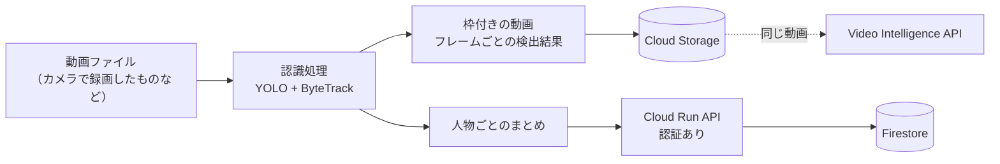

# 画像・動画による人物認識と Google Cloud のハンズオン計画

この文書は、ハンズオン全体の計画と、各 Step の概要をまとめたものです。コマンドやプログラムなどの具体的な手順は、各 Step の詳細手順書に書いています（第4章の各 Step からリンクしています）。

## 1. 目的と進め方

このハンズオンでは、画像・動画から人物を認識する処理をローカル PC で作り、同じ処理を Google Cloud 上でも動かせるようにします。

いきなりクラウドで動かすことはせず、まずローカルで認識処理を完成させます。そのあと、結果をクラウドに保存し、Google の認識 API と比べ、Docker 化して Compute Engine で実行し、最後に GPU を試します。

### この計画で扱う「人物の認識」

「人物の認識」にはいくつかの段階があります。どこまでをどの Step で扱うかを先に決めておきます。

| 段階               | 内容                                                  | 扱う Step         |
| ------------------ | ----------------------------------------------------- | ----------------- |
| 検出               | 画像の中のどこに人がいるか                            | Step 1            |
| 追跡               | 動画の中で同じ人に同じ ID を付け続ける                | Step 2            |
| 数える・動きを見る | 人数、線を越えた人数、決めた範囲にいた時間            | Step 3            |
| 姿勢               | 関節の位置（立つ・座る・手を挙げる など）             | Step 3            |
| 精度を知る         | どんなときに見落とし・誤検出・ID の取り違えが起きるか | Step 3            |
| 本人の特定         | 顔などから「誰か」を当てる                            | 追加課題（第6章） |

### 最終的に作るシステム

1. 動画ファイル（公開のサンプル動画や、Windows のカメラアプリで録画したもの）から映像を取得する
2. Python・OpenCV で映像をフレームに分ける
3. YOLO で人物を検出し、ByteTrack で追跡する
4. 枠を描いた動画とフレームごとの検出結果を Cloud Storage に保存する
5. 人物ごとのまとめ（いつからいつまで映っていたか など）を、認証付きの Cloud Run API 経由で Firestore に保存する
6. 同じ動画を Google の Video Intelligence API にもかけ、自分で動かす YOLO と比べる
7. 同じ認識処理を Compute Engine 上のコンテナで動かし、CPU と GPU で比べる

## 2. 使用する技術・サービス

| 分野               | 技術・サービス         | 役割                                                  |
| ------------------ | ---------------------- | ----------------------------------------------------- |
| ローカルの実行環境 | WSL2（Ubuntu 24.04）   | Step 1〜5 の開発・実行。Step 6 の Docker と同じ Linux |
| 開発言語           | Python 3.13            | 認識処理全体                                          |
| パッケージ管理     | uv                     | Python 環境・依存関係の管理（ロックファイルで固定）   |
| 画像処理           | OpenCV                 | 動画の読み込み、フレームの取り出し、動画の書き出し    |
| AI モデル          | Ultralytics YOLO       | 人物の検出・姿勢推定                                  |
| 追跡               | ByteTrack              | フレーム間で同じ人物を追跡                            |
| コンテナ           | Docker                 | ローカルとクラウドの実行環境をそろえる                |
| イメージ保管       | Artifact Registry      | Docker イメージの保管                                 |
| イメージ作成       | Cloud Build            | クラウドで Docker イメージを作る                      |
| API                | Cloud Run              | 認識結果のまとめを受け取って保存する（認証あり）      |
| データ保存         | Firestore              | 動画ごと・人物ごとのまとめ                            |
| ファイル保存       | Cloud Storage          | 元動画、枠付き動画、フレームごとの検出結果            |
| 認識 API           | Video Intelligence API | Google が用意した人物検出。YOLO との比較用            |
| AI 実行環境        | Compute Engine         | クラウド上で YOLO を実行（CPU → GPU）                 |

### Cloud Run と Compute Engine の役割

- **Cloud Run**：認識結果を受け取って保存する API など、軽い処理を担当します。
- **Compute Engine**：OpenCV と YOLO による認識処理を実行します。
- **Cloud Run Jobs**：動画1本ごとのバッチ処理を、VM を管理せずに動かす選択肢です。Compute Engine を経験したあとに比べると、違いが分かりやすくなります。
- **Cloud Run の GPU**：Cloud Run でも GPU（NVIDIA L4）を使えますが、東京リージョンには対応していません。このハンズオンでは GPU を Compute Engine で使い、Cloud Run の GPU は紹介だけにとどめます。

最初からすべてのサービスを使う必要はありません。Step ごとに追加します。

## 3. 始める前に決めておくこと

### 3-1. 使う映像のルール

人が映った映像は、個人を識別できれば個人情報になります。ハンズオンでも次を守ります。

- 練習に使う映像は次のどれかに限る
  - 自分で撮影し、映る人全員から許可を取ったもの
  - 公開データセット・公開のサンプル動画（例：OpenCV のサンプル動画、MOT17。MOT17 は非商用ライセンスなので、学習目的に限る）
  - 利用条件を確認したフリー素材
- 動画・検出結果は Git にコミットしない
- クラウドに上げるバケットは非公開にし、一定期間で自動削除する（Step 4）
- 使い終わった録画は、ローカルからも削除する（Step 8）
- 参考：経済産業省・総務省「カメラ画像利活用ガイドブック」

### 3-2. ライセンス

- **Ultralytics YOLO は AGPL-3.0** です。社内の学習用で使うぶんには問題になりにくいものの、作ったものを業務システムやサービスに流用する場合は、ソースコードの公開義務がかかるか、Ultralytics の Enterprise ライセンスが必要になります。その段階で、ライセンスを買うか、別のモデル（RT-DETR 系など、ライセンスの緩いもの）に替えるかを判断します。
- 顔認識（第6章）で使うモデルにも、商用利用できないものがあります。

### 3-3. リージョン

リージョンは東京（`asia-northeast1`）にそろえます。人物の映像を国内に置けるためです。Compute Engine の GPU も東京で使えます。ただし米国リージョンより料金がやや高く、GPU の在庫が一時的に足りないこともあります。

次の2つは東京リージョンに対応していないため、使うと映像が国外で処理されます。

- Video Intelligence API（Step 5）
- Cloud Run の GPU（このハンズオンでは使わない）

国外のリージョンに渡す映像は、架空の映像や公開データセットなど、国外で処理されても問題がないものに限ります。

### 3-4. ローカルの実行環境（WSL）

ローカルでの開発と実行は、Windows ではなく **WSL2 の Ubuntu** で行います。

| 理由                              | 内容                                                                                                                                                                            |
| --------------------------------- | ------------------------------------------------------------------------------------------------------------------------------------------------------------------------------- |
| Windows では PyTorch が動かない   | この PC では Windows 11 の Smart App Control がオンになっています。署名のない `torch.dll` などが読み込みを止められます。WSL の中の Linux のプログラムは、この仕組みの対象外です |
| Docker と同じ Linux で動かせる    | Step 6 で VM に載せる Docker イメージも Linux です。ローカルと同じ環境になるので、「ローカルでは動いたのにクラウドでは動かない」というずれが減ります                            |
| PyTorch の CPU 版を最初から使える | Linux の PyTorch は、そのまま入れると GPU 版（数GB）になります。最初から CPU 版にしておくと、ダウンロードが小さく、Docker イメージとも同じになります                            |

WSL を使うと、次の2点が変わります。

- **Web カメラは直接使わない**：カメラの映像は、Windows のカメラアプリで録画した動画ファイルとして使います（Step 2）
- **画面表示は WSLg で出る**：処理中の映像のウィンドウは、Windows 11 の WSLg により Windows 側に表示されます

WSL での開発が会社のルールで認められていることを、事前に確認しておきます。

### 3-5. セキュリティの方針

| 方針                                                                                                                    | 扱う Step |
| ----------------------------------------------------------------------------------------------------------------------- | --------- |
| サービスアカウントの鍵（JSON ファイル）を作らない。ローカルは自分のログイン、クラウドはサービスに付けたアカウントを使う | Step 4〜7 |
| API は認証ありで公開し、受け取る項目と値の範囲を決める                                                                  | Step 4    |
| サービスアカウントには、必要な権限を、必要な場所にだけ付ける                                                            | Step 4・6 |
| バケットは非公開にし、30日で自動削除する                                                                                | Step 4    |
| 人物に関するデータをログに出さない                                                                                      | Step 4    |
| コンテナは管理者ではない利用者で動かす                                                                                  | Step 4・6 |

## 4. 各 Step の概要

各 Step の詳細手順書の最後に「完了条件」を置いています。すべて満たしてから次へ進みます。

| Step | 内容                                     | 場所                      | 詳細手順書                                              |
| ---- | ---------------------------------------- | ------------------------- | ------------------------------------------------------- |
| 1    | 画像から人物を検出する                   | ローカル（WSL）           | [[image-video-recognition-step1-local-image-detection]] |
| 2    | 動画から人物を検出・追跡する             | ローカル（WSL）           | [[image-video-recognition-step2-local-video-tracking]]  |
| 3    | 人物の認識を深める（数える・姿勢・精度） | ローカル（WSL）           | [[image-video-recognition-step3-person-analysis]]       |
| 4    | Google Cloud に結果を保存する            | ローカル＋Google Cloud    | [[image-video-recognition-step4-cloud-storage-api]]     |
| 5    | Google の認識 API と比べる               | ローカル＋Google Cloud    | [[image-video-recognition-step5-video-intelligence]]    |
| 6    | AI の処理を Compute Engine 上で実行する  | Google Cloud（CPU の VM） | [[image-video-recognition-step6-compute-engine]]        |
| 7    | GPU を使って性能を比べる（任意）         | Google Cloud（GPU の VM） | [[image-video-recognition-step7-gpu]]                   |
| 8    | 後片付け                                 | Google Cloud＋ローカル    | [[image-video-recognition-step8-cleanup]]               |

### Step 1：ローカル PC で画像から人物を検出する

詳細手順書：[[image-video-recognition-step1-local-image-detection]]

- **目的**：AI の物体検出の基本（何が・どれくらいの自信で・どこに）を知る
- **やること**
  - WSL に uv を入れ、Python 3.13 のプロジェクトを作る（PyTorch は CPU 版にする）
  - 学習済みの YOLO で、サンプル画像の人物を検出し、枠を描いた画像を保存する
  - 信頼度のしきい値を変えて、見落としと誤検出がどう入れ替わるかを確かめる
- **できあがるもの**：画像から人物を検出するプログラム、AI モデル（`yolo11n.pt`）
- **完了条件**：結果の画像で人物に `person` の枠が付き、検出結果の3つの要素（クラス・信頼度・位置）を説明できる

### Step 2：ローカル PC で動画から人物を検出・追跡する

詳細手順書：[[image-video-recognition-step2-local-video-tracking]]

- **目的**：動画をフレームごとに処理する仕組みと、検出と追跡の違いを知る
- **やること**
  - 公開のサンプル動画（広場を歩く人々を撮った約80秒の動画）を用意する
  - 人物だけを検出し、ByteTrack で同じ人に同じ ID を付け続ける
  - 枠付きの動画、フレームごとの検出結果、人物ごとのまとめの3つを保存する
  - カメラアプリで録画した動画でも試し、処理の速さ（FPS）を記録する
- **できあがるもの**：動画の認識プログラム（Step 6 のクラウドでもそのまま使う）
- **完了条件**：人物に追跡 ID 付きの枠が出て、ID の数が実際の人数と違うことがある理由を説明できる

### Step 3：人物の認識を深める

詳細手順書：[[image-video-recognition-step3-person-analysis]]

- **目的**：人物ならではの課題を解き、AI がどんな条件で間違えるかを知る
- **やること**
  - Step 2 の結果を読んで、線を越えた人数と、決めた範囲にいた時間を数える
  - 姿勢推定で関節の位置を求め、手を挙げている人を判定する
  - しきい値ごとの見落とし・誤検出と、ID の取り違えを、目で確かめて表にまとめる
  - 数え方が正しいかを、テストで確かめる（発展）
- **できあがるもの**：数える・姿勢・精度確認のプログラム、精度の表
- **完了条件**：精度の表を作り、このモデルが苦手な条件を3つ挙げられる

### Step 4：Google Cloud に結果を保存する

詳細手順書：[[image-video-recognition-step4-cloud-storage-api]]

- **目的**：AI の処理はローカルのまま、結果を安全にクラウドへ保存する
- **やること**
  - プロジェクトを作り、課金と予算アラートを設定する。WSL に gcloud を入れてログインする
  - 非公開で30日で自動削除するバケットを作り、動画と結果のファイルを保存する
  - Firestore を作る（人物ごとのまとめだけを入れる）
  - まとめを受け取って Firestore に保存する API を作り、手元でテストしてから、認証ありで Cloud Run にデプロイする
  - ローカルから API にまとめを送る
- **できあがるもの**：バケット、Firestore、認証付きの API、API に送るプログラム
- **完了条件**：認証なしの呼び出しが拒否され、送ったまとめが Firestore に入り、決めていない項目のデータが拒否される

### Step 5：Google の認識 API と比べる

詳細手順書：[[image-video-recognition-step5-video-intelligence]]

- **目的**：自分で動かす YOLO と、Google の API の向き・不向きを知る
- **やること**
  - 同じサンプル動画を Video Intelligence API にかける（結果は保存し、API を呼ぶのは1回だけにする）
  - Step 3 と同じフレームで、YOLO と API の検出結果を画像と表で比べる
  - 精度・処理時間・料金・手間・データの置き場所を表にまとめる
- **注意**：API は東京リージョンに対応していないため、公開のサンプル動画だけを使う
- **完了条件**：比べた表を埋め、どちらを選ぶかを自分の言葉で説明できる

### Step 6：AI の処理を Compute Engine 上で実行する

詳細手順書：[[image-video-recognition-step6-compute-engine]]

- **目的**：ローカルと同じ認識処理を、Docker にまとめてクラウドの VM で動かす
- **やること**
  - Cloud Storage から動画を取り、認識し、結果を保存して API に送るプログラムを作る
  - ローカルと同じライブラリの版で Docker イメージを作り、WSL の Docker で試す
  - Cloud Build でイメージを作り、Artifact Registry に保存する
  - 必要な権限だけを持つアカウントを付けた VM で、コンテナを動かし、処理時間を測る
  - 測り終わったら VM を削除する
- **できあがるもの**：認識処理の Docker イメージ（CPU 版）
- **完了条件**：VM で処理した結果が Cloud Storage と Firestore に入り、処理時間を記録して、VM を削除した

### Step 7：GPU を使って性能を比べる（任意）

詳細手順書：[[image-video-recognition-step7-gpu]]

- **目的**：GPU で速くなるかを、時間と料金の両方で確かめる
- **やること**
  - GPU の割り当ての引き上げを申請する（承認に時間がかかるので、早めに）
  - Git の別のブランチで PyTorch を GPU 版にして、GPU 版のイメージを作る
  - NVIDIA T4 を付けた VM で同じ処理を動かし、ローカル・CPU の VM・API と比べる
  - 測り終わったら VM を削除する
- **できあがるもの**：認識処理の Docker イメージ（GPU 版）、処理時間と料金の比較表
- **完了条件**：比較表を埋め、この用途に GPU が必要かを数字で説明できる

### Step 8：後片付け

詳細手順書：[[image-video-recognition-step8-cleanup]]

- **目的**：作ったものを残さず、料金がかからない状態にする
- **やること**
  - VM を削除する
  - ハンズオン専用のプロジェクトなら、プロジェクトごと削除する（他の用途にも使っているなら、作ったものを1つずつ削除する）
  - 人が写った録画と結果を、WSL と Windows の両方から削除する
  - ローカルのログイン情報を消す
  - 翌日以降に、料金が増えていないことを確かめる
- **完了条件**：作ったものが残っておらず、料金が増えていない

## 5. 発展：プログラムの構成

ハンズオンでは分かりやすさのために、プログラムをプロジェクトの一番上のフォルダに並べています。続けて育てる場合は、役割ごとにフォルダを分けます。

| フォルダ               | 入れるもの                                                                                                                |
| ---------------------- | ------------------------------------------------------------------------------------------------------------------------- |
| 認識（recognition）    | AI による検出・姿勢推定                                                                                                   |
| 追跡・集計（tracking） | 追跡と、線を越えた人数・範囲にいた時間などの集計                                                                          |
| クラウド連携（cloud）  | Google Cloud への送信・保存                                                                                               |
| API（api）             | Cloud Run で動く API                                                                                                      |
| テスト（tests）        | まずは集計のテストから書く。モデルを使わず、座標の並びを与えて結果を確かめられるため（Step 3 で書いたテストが土台になる） |

## 6. 追加課題：顔認識による人物の特定

人物の検出・追跡ができたら、必要に応じて顔による本人の特定を加えます。

| 技術            | 役割                               |
| --------------- | ---------------------------------- |
| RetinaFace など | 顔の検出                           |
| ArcFace など    | 顔画像を特徴量（数値の並び）に変換 |
| 類似度の計算    | 登録済みの特徴量と照合             |
| Firestore など  | 出社記録などの保存                 |

顔認識では、顔の検出、特徴量の抽出、登録データとの照合を組み合わせます。

本人の特定は、他の課題より扱いが重くなります。

- **顔の特徴量は、個人情報保護法の「個人識別符号」に当たります。** それだけで個人情報になります。
- 社員の顔を使う場合は、実際のデータを使う前に、利用目的の明示、同意・通知、保存期間、アクセスできる人の制限、誤認識したときの確認方法を設計します。
- ハンズオンでは、架空のデータか利用許可を得たテスト画像から始めます。
- 使うモデルやライブラリの商用利用条件を確認します。研究用途に限られているものもあります。
- 誤認識の影響が大きい用途（入退室の制御など）では、精度の評価（Step 3 と同じ考え方）を必ず行い、人が確認する手順を残します。

## 7. 学習計画（4週間＋任意1週）

| 週            | 学習内容                                                                                       | 到達目標                                                                        |
| ------------- | ---------------------------------------------------------------------------------------------- | ------------------------------------------------------------------------------- |
| 1週目         | Step 1・2：画像と動画の検出、追跡、FPS の計測                                                  | 動画の人物を追跡 ID 付きで保存でき、FPS を測れる                                |
| 2週目         | Step 3：線を越えた人数、滞在時間、姿勢、精度の評価                                             | 人物の認識が、どんな条件で間違えるかを説明できる                                |
| 3週目         | Step 4・5：Cloud Storage、Firestore、認証付きの Cloud Run API、Video Intelligence API との比較 | 結果を安全にクラウドへ保存でき、自前の YOLO と Google の API の違いを説明できる |
| 4週目         | Step 6・8：Docker、Artifact Registry、Compute Engine（CPU）、後片付け                          | クラウドの VM で同じ認識処理を動かせる                                          |
| 5週目（任意） | Step 7：GPU の割り当て申請、GPU の VM、速度と料金の比較                                        | GPU が必要になる条件を数字で説明できる                                          |

GPU の割り当ては、承認まで時間がかかることがあります。GPU を試すなら、3週目のうちに申請しておきます。

## 8. 費用を抑えるための注意点

- Google Cloud を使い始めるときに、予算アラートを設定する（通知だけで、利用は止まらない）
- ハンズオン専用のプロジェクトを作る（後片付けでプロジェクトごと削除できる）
- Step 1〜3 はローカル PC（WSL）の CPU で行う
- Firestore にはまとめだけを入れ、フレームごとのデータは Cloud Storage に置く
- Cloud Storage は30日で自動削除する
- Video Intelligence API は処理した動画の長さで課金されるので、結果を保存して、API を呼ぶのは1回だけにする
- VM は測り終わったらすぐに削除する。停止してもディスクの料金は残る
- GPU 付きの VM は、CPU で足りないと確かめてから使う
- 終わったら Step 8 で片付け、翌日以降に料金を確かめる

## 9. 最初に着手すること

1. 練習に使う映像を決める（第3章のルールに従う）
2. WSL での開発が会社のルールで認められていることを確認する
3. Step 1 の詳細手順書に沿って、WSL に uv を用意し、サンプル画像の人物を検出する
4. Step 2 で動画の人物を追跡する

最初の成果物は、動画の人物に追跡 ID 付きの枠を描いて保存し、人物ごとのまとめを出力する Python プログラムです。これを完成させてから、Google Cloud に進みます。

---

## 参考情報

料金、使えるリージョン、GPU の提供状況、ライブラリのバージョンは変わります。実際に構築するときは公式ドキュメントで確認してください。

- [Google Cloud Compute Engine](https://cloud.google.com/compute)
- [Compute Engine の GPU](https://cloud.google.com/compute/docs/gpus)
- [Google Cloud Run](https://cloud.google.com/run)
- [Google Cloud Storage](https://cloud.google.com/storage)
- [Google Cloud Firestore](https://cloud.google.com/firestore)
- [Google Cloud Artifact Registry](https://cloud.google.com/artifact-registry)
- [Cloud Build](https://cloud.google.com/build)
- [Video Intelligence API](https://cloud.google.com/video-intelligence)
- [Vision API](https://cloud.google.com/vision)
- [Ultralytics YOLO Documentation](https://docs.ultralytics.com/)
- [Ultralytics のライセンス](https://www.ultralytics.com/license)
- [uv で PyTorch を使う](https://docs.astral.sh/uv/guides/integration/pytorch/)
- [OpenCV Documentation](https://docs.opencv.org/)
