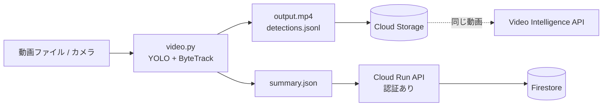

# 画像・動画による人物認識と Google Cloud のハンズオン構築手順

## 1. 目的と進め方

このハンズオンでは、画像・動画から人物を認識する処理をローカル PC で作り、同じ処理を Google Cloud 上でも動かせるようにします。

いきなりクラウドで動かすことはせず、まずローカルで認識処理を完成させます。そのあと、結果をクラウドに保存し、Google の認識 API と比べ、Docker 化して Compute Engine で実行し、最後に GPU を試します。

### この計画で扱う「人物の認識」

「人物の認識」にはいくつかの段階があります。どこまでをどの Step で扱うかを先に決めておきます。

| 段階 | 内容 | 扱う Step |
|---|---|---|
| 検出 | 画像の中のどこに人がいるか | Step 1 |
| 追跡 | 動画の中で同じ人に同じ ID を付け続ける | Step 2 |
| 数える・動きを見る | 人数、線を越えた人数、決めた範囲にいた時間 | Step 3 |
| 姿勢 | 関節の位置（立つ・座る・手を挙げる など） | Step 3 |
| 精度を知る | どんなときに見落とし・誤検出・ID の取り違えが起きるか | Step 3 |
| 本人の特定 | 顔などから「誰か」を当てる | 追加課題（第6章） |

### 最終的に作るシステム



1. カメラまたは動画ファイルから映像を取得する
2. Python・OpenCV で映像をフレームに分ける
3. YOLO で人物を検出し、ByteTrack で追跡する
4. 枠を描いた動画とフレームごとの検出結果を Cloud Storage に保存する
5. 人物ごとのまとめ（いつからいつまで映っていたか など）を、認証付きの Cloud Run API 経由で Firestore に保存する
6. 同じ動画を Google の Video Intelligence API にもかけ、自分で動かす YOLO と比べる
7. 同じ認識プログラムを Compute Engine 上のコンテナで動かす

## 2. 使用する技術・サービス

| 分野 | 技術・サービス | 役割 |
|---|---|---|
| 開発言語 | Python 3.12 | 認識処理全体 |
| パッケージ管理 | uv | Python 環境・依存関係の管理（ロックファイルで固定） |
| 画像処理 | OpenCV | 動画の読み込み、フレームの取り出し、動画の書き出し |
| AI モデル | Ultralytics YOLO | 人物の検出・姿勢推定 |
| 追跡 | ByteTrack | フレーム間で同じ人物を追跡 |
| コンテナ | Docker | ローカルとクラウドの実行環境をそろえる |
| イメージ保管 | Artifact Registry | Docker イメージの保管 |
| API | Cloud Run | 認識結果のまとめを受け取って保存する（認証あり） |
| データ保存 | Firestore | 動画ごと・人物ごとのまとめ |
| ファイル保存 | Cloud Storage | 元動画、枠付き動画、フレームごとの検出結果 |
| 認識 API | Video Intelligence API | Google が用意した人物検出。YOLO との比較用 |
| AI 実行環境 | Compute Engine | クラウド上で YOLO を実行（CPU → GPU） |

### Cloud Run と Compute Engine の役割

- **Cloud Run**：認識結果を受け取って保存する API など、軽い処理を担当します。
- **Compute Engine**：OpenCV と YOLO による認識処理を実行します。
- **Cloud Run Jobs**：動画1本ごとのバッチ処理を、VM を管理せずに動かす選択肢です。Compute Engine を経験したあとに比べると、違いが分かりやすくなります。
- **Cloud Run の GPU**：Cloud Run でも GPU（NVIDIA L4）を使えますが、東京リージョンには対応していません。このハンズオンでは GPU を Compute Engine で使い、Cloud Run の GPU は紹介だけにとどめます。

最初からすべてのサービスを使う必要はありません。Step ごとに追加します。

## 3. 始める前に決めておくこと

### 3-1. 使う映像のルール

人が映った映像は、個人を識別できれば個人情報になります。ハンズオンでも次を守ります。

- 練習に使う映像は次のどれかに限る
  - 自分で撮影し、映る人全員から許可を取ったもの
  - 公開データセット（例：MOT17。非商用ライセンスなので、学習目的に限る）
  - 利用条件を確認したフリー素材
- 動画・検出結果は Git にコミットしない（`.gitignore` に `*.mp4`、`out/` を入れる）
- クラウドに上げるバケットは非公開にし、一定期間で自動削除する（Step 4 で設定）
- 参考：経済産業省・総務省「カメラ画像利活用ガイドブック」

### 3-2. ライセンス

- **Ultralytics YOLO は AGPL-3.0** です。社内の学習用で使うぶんには問題になりにくいものの、作ったものを業務システムやサービスに流用する場合は、ソースコードの公開義務がかかるか、Ultralytics の Enterprise ライセンスが必要になります。その段階で、ライセンスを買うか、別のモデル（RT-DETR 系など、ライセンスの緩いもの）に替えるかを判断します。
- 顔認識（第6章）で使うモデルにも、商用利用できないものがあります。

### 3-3. リージョン

リージョンは東京（`asia-northeast1`）にそろえます。人物の映像を国内に置けるためです。Compute Engine の GPU も東京で使えます。ただし米国リージョンより料金がやや高く、GPU の在庫が一時的に足りないこともあります。

次の2つは東京リージョンに対応していないため、使うと映像が国外で処理されます。

- Video Intelligence API（Step 5）
- Cloud Run の GPU（このハンズオンでは使わない）

国外のリージョンに渡す映像は、架空の映像や公開データセットなど、国外で処理されても問題がないものに限ります。

## 4. 構築手順

各 Step の最後に「完了条件」を置いています。すべて満たしてから次へ進みます。

### Step 1：ローカル PC で画像から人物を検出する

まず Google Cloud を使わず、ローカル PC だけで動かします。Web カメラを使うので、WSL や DevContainer ではなく Windows 上で直接動かします（WSL やコンテナからは、カメラを使うのに手間がかかります）。

> 環境の準備から結果の読み方まで詳しく書いた手順書：[[image-video-recognition-step1-local-image-detection]]

#### 開発環境

- Python 3.12
- uv
- OpenCV
- Ultralytics YOLO（PyTorch も一緒に入ります）
- lap（ByteTrack が使うパッケージ。Step 2 で必要です）

#### プロジェクト作成・ライブラリ導入

```bash
mkdir image-recognition-handson
cd image-recognition-handson

uv init --python 3.12
uv add opencv-python ultralytics lap
```

`lap` は、足りないときに Ultralytics が pip で自動インストールしようとします。しかし uv の環境では pip が無いため失敗することがあるので、最初に入れておきます。

#### サンプルコード

`main.py` を次の内容で上書きします。

```python
from ultralytics import YOLO

# 学習済みの小型モデルを読み込む（初回はダウンロードされる）
model = YOLO("yolo11n.pt")

# 画像を推論する（conf は信頼度のしきい値）
results = model("sample.jpg", conf=0.25)

for result in results:
    for box in result.boxes:
        class_id = int(box.cls[0])
        x1, y1, x2, y2 = box.xyxy[0].tolist()
        print({
            "class": model.names[class_id],
            "confidence": round(float(box.conf[0]), 3),
            "bbox": [round(v) for v in (x1, y1, x2, y2)],  # 左上と右下の座標（ピクセル）
        })

    # 枠を描いた画像を保存
    result.save(filename="result.jpg")
```

実行します。

```bash
uv run python main.py
```

`sample.jpg` に人物が写っていれば、`class` が `person` の行が表示され、枠を描いた画像が `result.jpg` に保存されます。

#### この段階で理解すること

1. Python で画像を読み込み、モデルに渡す方法
2. 検出結果の3つの要素：クラス（何か）、信頼度（どれくらい自信があるか）、位置（`bbox`）
3. `conf` を 0.1 と 0.7 に変えると、検出の数がどう変わるか

一般的な物体や人物を検出するだけなら、自分でモデルを学習させる必要はありません。学習済みモデル（COCO データセットの80クラス。`person` はクラス番号0）を使います。

#### 完了条件

- [ ] `result.jpg` で、人物に枠と `person` のラベルが付いている
- [ ] `conf` を変えたときに検出の数がどう変わるかを説明できる

### Step 2：ローカル PC で動画から人物を検出・追跡する

動画はフレーム（1枚1枚の画像）の連続なので、フレームごとに検出します。さらに、同じ人物に同じ ID を付け続ける「追跡（Tracking）」を加えます。

このプログラムは Step 6 でクラウドでもそのまま使います。そのため最初から次のように作ります。

- 画面への表示は `--show` を付けたときだけにする（VM や Docker には画面がないため）
- 枠を描いた動画は、常にファイルに書き出す
- クラウドへの送信処理は入れない（認識処理とクラウド連携を分ける）

#### サンプルコード

`video.py` を作成します。

```python
"""動画から人物を検出・追跡し、結果をファイルに保存する。"""
import argparse
import json
import re
import time
from pathlib import Path

import cv2
from ultralytics import YOLO

PERSON_CLASS_ID = 0  # COCO の「person」


def make_video_id(source: str) -> str:
    """ファイル名から、英数字・_・- だけの ID を作る。"""
    stem = f"camera{source}" if source.isdigit() else Path(source).stem
    return re.sub(r"[^A-Za-z0-9_-]", "_", stem)[:64] or "video"


def run(source: str, out_dir: Path, *, model_path: str = "yolo11n.pt", conf: float = 0.4,
        show: bool = False, detect_only: bool = False) -> Path:
    out_dir.mkdir(parents=True, exist_ok=True)
    model = YOLO(model_path)
    cap = cv2.VideoCapture(int(source) if source.isdigit() else source)
    if not cap.isOpened():
        raise SystemExit(f"映像を開けません: {source}")

    fps = cap.get(cv2.CAP_PROP_FPS) or 30.0
    size = (int(cap.get(cv2.CAP_PROP_FRAME_WIDTH)), int(cap.get(cv2.CAP_PROP_FRAME_HEIGHT)))
    writer = cv2.VideoWriter(str(out_dir / "output.mp4"), cv2.VideoWriter_fourcc(*"mp4v"), fps, size)

    tracks: dict[int, dict] = {}  # 追跡 ID ごとのまとめ
    frame_number = 0
    with open(out_dir / "detections.jsonl", "w", encoding="utf-8") as log:
        while True:
            ok, frame = cap.read()
            if not ok:
                break

            start = time.perf_counter()
            if detect_only:
                result = model(frame, classes=[PERSON_CLASS_ID], conf=conf, verbose=False)[0]
            else:
                result = model.track(frame, persist=True, tracker="bytetrack.yaml",
                                     classes=[PERSON_CLASS_ID], conf=conf, verbose=False)[0]
            proc_fps = 1 / (time.perf_counter() - start)

            boxes = result.boxes
            ids = boxes.id.int().tolist() if boxes.id is not None else [None] * len(boxes)
            for track_id, xyxy, score in zip(ids, boxes.xyxy.tolist(), boxes.conf.tolist()):
                # フレームごとの検出結果（細かいデータはファイルに残す）
                log.write(json.dumps({
                    "frame": frame_number,
                    "tracking_id": track_id,
                    "confidence": round(score, 3),
                    "bbox": [round(v) for v in xyxy],
                }) + "\n")
                if track_id is not None:
                    t = tracks.setdefault(track_id, {"first": frame_number, "last": frame_number, "max_conf": 0.0})
                    t["last"] = frame_number
                    t["max_conf"] = max(t["max_conf"], score)

            annotated = result.plot()
            cv2.putText(annotated, f"persons: {len(boxes)}  FPS: {proc_fps:.1f}", (10, 30),
                        cv2.FONT_HERSHEY_SIMPLEX, 1, (0, 255, 0), 2)
            writer.write(annotated)

            if show:
                cv2.imshow("Detection", annotated)
                if cv2.waitKey(1) & 0xFF == ord("q"):
                    break
            frame_number += 1

    cap.release()
    writer.release()
    if show:
        cv2.destroyAllWindows()

    # 人物ごとのまとめ（Step 4 で Firestore に保存するのはこれだけ）
    summary = {
        "video_id": make_video_id(source),
        "fps": round(fps, 2),
        "frame_count": frame_number,
        "person_tracks": [
            {
                "tracking_id": tid,
                "first_seen_sec": round(t["first"] / fps, 2),
                "last_seen_sec": round(t["last"] / fps, 2),
                "duration_sec": round((t["last"] - t["first"] + 1) / fps, 2),
                "max_confidence": round(t["max_conf"], 3),
            }
            for tid, t in sorted(tracks.items())
        ],
    }
    summary_path = out_dir / "summary.json"
    summary_path.write_text(json.dumps(summary, ensure_ascii=False, indent=2), encoding="utf-8")
    return summary_path


def main() -> None:
    parser = argparse.ArgumentParser(description="動画から人物を検出・追跡する")
    parser.add_argument("--source", default="sample.mp4", help="動画ファイルのパス、またはカメラ番号（0 など）")
    parser.add_argument("--out-dir", default="out", help="結果の保存先フォルダ")
    parser.add_argument("--conf", type=float, default=0.4, help="信頼度のしきい値")
    parser.add_argument("--show", action="store_true", help="画面に表示する（VM・Docker では付けない）")
    parser.add_argument("--detect-only", action="store_true", help="追跡せず検出だけ行う（比較用）")
    args = parser.parse_args()

    path = run(args.source, Path(args.out_dir), conf=args.conf, show=args.show, detect_only=args.detect_only)
    print(f"保存しました: {path}")


if __name__ == "__main__":
    main()
```

実行します。

```bash
# 動画ファイルを画面に表示しながら処理（q で終了）
uv run python video.py --source sample.mp4 --show

# 追跡せず検出だけ（追跡ありと見比べる）
uv run python video.py --source sample.mp4 --show --detect-only --out-dir out_detect

# Web カメラ（カメラ番号 0）
uv run python video.py --source 0 --show
```

`out/` に次の3つができます。

| ファイル | 中身 |
|---|---|
| `output.mp4` | 枠・追跡 ID・人数・FPS を描いた動画 |
| `detections.jsonl` | フレームごと・人物ごとの検出結果（1行1件） |
| `summary.json` | 人物（追跡 ID）ごとのまとめ |

#### この段階で理解すること

- 動画からフレームを取り出し、1枚ずつ推論する仕組み
- 検出（Detection）と追跡（Tracking）の違い：`--detect-only` では ID が付かない
- 処理速度（FPS）：画面左上の FPS が、元動画の FPS（多くは30）より低ければ、リアルタイムには間に合っていない
- 1分の動画でも `detections.jsonl` は数千行になる：Step 4 で Firestore にまとめだけを入れる理由

#### 完了条件

- [ ] `out/output.mp4` で、人物に追跡 ID 付きの枠が出ている
- [ ] 自分の PC での処理 FPS を記録した（Step 7 で GPU と比べる）
- [ ] Web カメラでも動いた

### Step 3：人物の認識を深める（ローカル）

Step 2 のプログラムを元に、人物に特有の課題を解きます。答えのコードは載せず、ヒントだけを示します。`video.py` をコピーした別ファイルで試します。

#### 3-1. 線を越えた人数を数える

画面に横線を1本決め、その線を上から下へ越えた人数を数えます。

```python
# ヒント：人物ごとに前のフレームの「足元の y 座標」を覚えておく
LINE_Y = 400
last_foot_y: dict[int, float] = {}
crossed: set[int] = set()

for track_id, (x1, y1, x2, y2) in zip(ids, boxes.xyxy.tolist()):
    if track_id is None:
        continue
    foot_y = y2  # 枠の下端 ≒ 足元
    prev = last_foot_y.get(track_id)
    if prev is not None and prev < LINE_Y <= foot_y:
        crossed.add(track_id)
    last_foot_y[track_id] = foot_y
```

`cv2.line` で線を描き、`len(crossed)` を画面に表示します。

#### 3-2. 決めた範囲にいた時間を測る

画面に四角い範囲を決め、足元がその範囲に入っていたフレーム数を人物ごとに数え、FPS で割って秒にします。

#### 3-3. 姿勢を推定する

```python
model = YOLO("yolo11n-pose.pt")
result = model(frame, verbose=False)[0]
keypoints = result.keypoints.xy  # 人数 × 17点 × (x, y)
```

17点は鼻・目・耳・肩・肘・手首・腰・膝・足首です。たとえば「手首が肩より上にある」ことから、手を挙げている人を判定してみます。

#### 3-4. 精度を確かめる

人物の認識で最も大事な作業です。どんなときに間違えるかを、自分の目で確かめて記録します。

1. 条件の違う短い動画を4〜5本用意する（人が重なる、暗い、遠い、後ろ向き、人が多い）
2. 各動画から10〜20フレームを選び、映っている人数を目で数える
3. 検出された人数と比べ、見落とし（いるのに検出されない）と誤検出（いないのに検出される）を数える
4. `--conf` を 0.25・0.4・0.6 に変えて、見落としと誤検出がどう入れ替わるかを見る
5. 2人がすれ違う場面で、追跡 ID が入れ替わったり（ID の取り違え）、新しい ID になったりしていないかを見る

結果は次のような表にまとめます。

| 条件 | conf | 実際の人数 | 検出数 | 見落とし | 誤検出 | ID の取り違え |
|---|---|---|---|---|---|---|
| 人が重なる | 0.4 | | | | | |

さらに進めるなら、正解データ付きの公開データセット（MOT17 など）と評価ツール（TrackEval など）を使い、数値で評価します。

#### 完了条件

- [ ] 線を越えた人数を数えて画面に表示できた
- [ ] 手を挙げている人を判定できた
- [ ] 精度の表を作り、「このモデルが苦手な条件」を3つ挙げられる

### Step 4：Google Cloud に結果を保存する

ここから Google Cloud を使います。この Step では、AI の処理はまだローカル PC で行い、結果だけをクラウドに保存します。

| サービス | 作成するもの | 用途 |
|---|---|---|
| Cloud Storage | バケット | 元動画、枠付き動画、`detections.jsonl` |
| Firestore | データベース | 動画ごと・人物ごとのまとめ |
| Cloud Run | API（認証あり） | まとめを受け取り、Firestore に保存 |

#### 4-1. Google Cloud プロジェクトの準備

1. Google Cloud Console でプロジェクトを作成する
2. 課金アカウントを紐付ける
3. **予算アラートを設定する**（例：月3,000円で通知。アラートは通知だけで、利用を止めるものではない）
4. Google Cloud CLI をローカル PC にインストールする
5. CLI でログインする

```bash
gcloud init
gcloud config set project YOUR_PROJECT_ID

# Python のライブラリ（Cloud Storage や Video Intelligence）が使う認証情報
gcloud auth application-default login
gcloud auth application-default set-quota-project YOUR_PROJECT_ID
```

サービスアカウントの鍵（JSON ファイル）は作りません。ローカル PC では上の認証情報を、VM では VM に付けたサービスアカウントを使います。

必要な API を有効にします。

```bash
gcloud services enable \
  run.googleapis.com \
  firestore.googleapis.com \
  storage.googleapis.com \
  artifactregistry.googleapis.com \
  cloudbuild.googleapis.com \
  compute.googleapis.com \
  videointelligence.googleapis.com
```

##### Cloud Build の権限

この先で使う `gcloud run deploy --source` と `gcloud builds submit` は、裏で Cloud Build を使います。権限は、ビルドを依頼する人と、ビルドを実行するサービスアカウントの2か所に必要です。

| 誰に | ロール | 用途 |
|---|---|---|
| ビルドを依頼するユーザー | Cloud Build Editor（`roles/cloudbuild.builds.editor`） | ビルドの作成・実行 |
| ビルドを実行するサービスアカウント | Artifact Registry Writer（`roles/artifactregistry.writer`） | Docker イメージの Push |
| 同上 | Logs Writer（`roles/logging.logWriter`） | Cloud Logging へのログ出力 |
| 同上 | Storage Bucket Viewer（`roles/storage.bucketViewer`） | ビルド用バケットの参照 |
| 同上 | Storage Object User（`roles/storage.objectUser`） | ビルド用バケットへのソースのアップロードなど |

プロジェクトのオーナーは、ユーザー側の権限を最初から持っています。オーナーでない人がビルドするときだけ、Cloud Build Editor を付けます。

新しいプロジェクトでは、ビルドを実行するサービスアカウントは Compute Engine のデフォルトのサービスアカウント（`プロジェクト番号-compute@developer.gserviceaccount.com`）です。このアカウントに4つのロールを付けます。

```bash
PROJECT_NUMBER=$(gcloud projects describe YOUR_PROJECT_ID --format='value(projectNumber)')
BUILD_SA="serviceAccount:${PROJECT_NUMBER}-compute@developer.gserviceaccount.com"

for ROLE in \
  roles/artifactregistry.writer \
  roles/logging.logWriter \
  roles/storage.bucketViewer \
  roles/storage.objectUser; do
  gcloud projects add-iam-policy-binding YOUR_PROJECT_ID --member="$BUILD_SA" --role="$ROLE"
done
```

プロジェクト全体に付けるため、このサービスアカウントは、認識結果のバケットを含むすべてのバケットのファイルを読み書きできるようになります。ハンズオン専用のプロジェクトなら、これで構いません。業務で使うときは、ビルド専用のサービスアカウントを作り、Storage のロールはビルド用のバケットにだけ付けます。

このハンズオンの VM には、デフォルトのサービスアカウントではなく、専用のサービスアカウント（Step 6-6）を付けます。そうすれば、上の権限が VM に渡ることはありません。

#### 4-2. Cloud Storage の作成

バケットは非公開にし、公開できない設定にします。

```bash
gcloud storage buckets create gs://YOUR_PROJECT_ID-recognition-data \
  --location=asia-northeast1 \
  --uniform-bucket-level-access \
  --public-access-prevention
```

30日たったファイルを自動で削除します。`lifecycle.json` を作ります。

```json
{
  "rule": [
    { "action": { "type": "Delete" }, "condition": { "age": 30 } }
  ]
}
```

```bash
gcloud storage buckets update gs://YOUR_PROJECT_ID-recognition-data \
  --lifecycle-file=lifecycle.json
```

保存先の構成は次のとおりです。

```text
gs://YOUR_PROJECT_ID-recognition-data/
├── input/
│   └── sample.mp4
└── output/
    └── sample/              ← video_id
        ├── output.mp4
        ├── detections.jsonl
        └── summary.json
```

ローカルの結果をアップロードします。

```bash
gcloud storage cp sample.mp4 gs://YOUR_PROJECT_ID-recognition-data/input/sample.mp4
gcloud storage cp out/* gs://YOUR_PROJECT_ID-recognition-data/output/sample/
```

#### 4-3. Firestore の作成

```bash
gcloud firestore databases create --location=asia-northeast1
```

ロケーションはあとから変更できません。

##### データの持ち方

フレームごと・人物ごとに1件ずつ書くと、30fps で3人が映る1分の動画だけで約5,400件になります。Firestore は書き込み件数で課金され、無料枠は1日2万件です。そのため Firestore には**まとめだけ**を入れ、フレームごとの細かいデータは Cloud Storage の `detections.jsonl` に置きます。

```text
videos/{video_id}                 ← 動画1本につき1件
  fps, frame_count, person_count, created_at（Timestamp 型）
  tracks/{tracking_id}            ← 人物1人につき1件
    first_seen_sec, last_seen_sec, duration_sec, max_confidence
```

この形なら、1分の動画に3人なら書き込みは4件です。フレームごとのデータを集計したくなったら、Firestore ではなく BigQuery に入れて分析します。

#### 4-4. Cloud Run で API を作成する

`summary.json` を受け取り、Firestore に保存する API を作ります。プロジェクトの中に `api/` フォルダを作り、本体とは別の uv プロジェクトにします。`--no-workspace` を付けないと、本体のプロジェクトの一部として登録されてしまいます。

```bash
mkdir api
cd api
uv init --app --no-workspace --python 3.12
uv add fastapi uvicorn google-cloud-firestore
cd ..
```

`api/main.py` を次の内容で上書きします。受け取る項目と値の範囲を pydantic で決め、それ以外の項目は受け付けません。

```python
from fastapi import FastAPI
from google.cloud import firestore
from pydantic import BaseModel, ConfigDict, Field

app = FastAPI()
db = firestore.Client()


class Track(BaseModel):
    model_config = ConfigDict(extra="forbid")  # 決めた項目以外は受け付けない

    tracking_id: int = Field(ge=0)
    first_seen_sec: float = Field(ge=0)
    last_seen_sec: float = Field(ge=0)
    duration_sec: float = Field(ge=0)
    max_confidence: float = Field(ge=0, le=1)


class VideoSummary(BaseModel):
    model_config = ConfigDict(extra="forbid")

    video_id: str = Field(pattern=r"^[A-Za-z0-9_-]{1,64}$")
    fps: float = Field(gt=0, le=240)
    frame_count: int = Field(ge=0)
    person_tracks: list[Track] = Field(max_length=499)  # まとめて書ける上限は500件


@app.post("/summaries", status_code=201)
def create_summary(summary: VideoSummary) -> dict:
    video_ref = db.collection("videos").document(summary.video_id)
    batch = db.batch()
    batch.set(video_ref, {
        "fps": summary.fps,
        "frame_count": summary.frame_count,
        "person_count": len(summary.person_tracks),
        "created_at": firestore.SERVER_TIMESTAMP,
    })
    for track in summary.person_tracks:
        batch.set(video_ref.collection("tracks").document(str(track.tracking_id)), track.model_dump())
    batch.commit()
    # 受け取った中身はログに出さない（人物に関するデータのため）
    return {"video_id": summary.video_id, "tracks": len(summary.person_tracks)}
```

`api/Dockerfile` を作ります（uv のイメージのバージョンは、ローカルの `uv --version` に合わせます）。

```dockerfile
FROM python:3.12-slim

COPY --from=ghcr.io/astral-sh/uv:0.8.0 /uv /bin/uv

WORKDIR /app
ENV UV_LINK_MODE=copy UV_COMPILE_BYTECODE=1 UV_PYTHON_DOWNLOADS=never

COPY pyproject.toml uv.lock ./
RUN uv sync --frozen --no-dev --no-install-project

COPY main.py ./

RUN useradd --create-home appuser
USER appuser
ENV PATH="/app/.venv/bin:$PATH"

CMD ["sh", "-c", "uvicorn main:app --host 0.0.0.0 --port ${PORT:-8080}"]
```

`api/.gcloudignore` を作り、ローカルの仮想環境をアップロードしないようにします。

```text
.venv/
__pycache__/
```

API 専用のサービスアカウントを作り、Firestore の読み書きだけを許可して、**認証ありで**デプロイします。

```bash
gcloud iam service-accounts create recognition-api

gcloud projects add-iam-policy-binding YOUR_PROJECT_ID \
  --member="serviceAccount:recognition-api@YOUR_PROJECT_ID.iam.gserviceaccount.com" \
  --role="roles/datastore.user"

gcloud run deploy recognition-api \
  --source=api \
  --region=asia-northeast1 \
  --service-account=recognition-api@YOUR_PROJECT_ID.iam.gserviceaccount.com \
  --no-allow-unauthenticated
```

`--no-allow-unauthenticated` により、`roles/run.invoker` を持つアカウントしか API を呼べません（プロジェクトのオーナーである自分は呼べます）。Step 6 では VM のサービスアカウントにだけ、このロールを付けます。

#### 4-5. ローカル PC から API に送る

本体のプロジェクトに、送信用のライブラリを追加します。

```bash
uv add google-auth requests google-cloud-storage
```

`cloud_client.py` を作成します。

```python
"""認識結果のまとめを Cloud Run API に送る。"""
import json
import os
import sys
from pathlib import Path

import google.auth.transport.requests
import google.oauth2.id_token
import requests


def get_id_token(audience: str) -> str:
    # ローカル：gcloud auth print-identity-token で取った値を環境変数 ID_TOKEN に入れておく
    token = os.environ.get("ID_TOKEN")
    if token:
        return token
    # VM・コンテナ：VM に付けたサービスアカウントで ID トークンを取る
    return google.oauth2.id_token.fetch_id_token(google.auth.transport.requests.Request(), audience)


def send_summary(api_url: str, summary_path: Path) -> None:
    summary = json.loads(Path(summary_path).read_text(encoding="utf-8"))
    response = requests.post(
        f"{api_url}/summaries",
        json=summary,
        headers={"Authorization": f"Bearer {get_id_token(api_url)}"},
        timeout=30,
    )
    response.raise_for_status()
    print(response.json())


if __name__ == "__main__":
    send_summary(os.environ["API_URL"], Path(sys.argv[1]))
```

送信します（bash の場合）。

```bash
export API_URL=$(gcloud run services describe recognition-api --region=asia-northeast1 --format='value(status.url)')
export ID_TOKEN=$(gcloud auth print-identity-token)
uv run python cloud_client.py out/summary.json
```

PowerShell の場合は、最初の2行を次のようにします。

```powershell
$env:API_URL = gcloud run services describe recognition-api --region=asia-northeast1 --format='value(status.url)'
$env:ID_TOKEN = gcloud auth print-identity-token
```

ID トークンの有効期限は約1時間です。トークンは画面やログに出さないようにします。

#### 完了条件

- [ ] バケットが非公開で、30日で削除する設定になっている
- [ ] Firestore の `videos/sample` と、その下の `tracks` にデータが入っている
- [ ] トークンを付けずに `curl -X POST $API_URL/summaries` を送ると 403 で拒否される

### Step 5：Google の認識 API と比べる

自分で YOLO を動かすほかに、Google が用意した API で人物を検出する方法もあります。同じ動画で比べ、それぞれの向き・不向きを知ります。

| API | できること |
|---|---|
| Video Intelligence API | 動画の人物検出と追跡、顔の検出、物体の追跡 |
| Vision API | 画像の物体検出（`Person` を返す）、顔の検出 |

どちらも顔の**検出**（どこに顔があるか）まではしますが、**本人の特定**（誰の顔か）はしません。本人の特定は、自分で作る必要があります（第6章）。

#### サンプルコード

```bash
uv add google-cloud-videointelligence
```

`compare_vi.py` を作成します。

```python
from google.cloud import videointelligence

client = videointelligence.VideoIntelligenceServiceClient()
config = videointelligence.PersonDetectionConfig(
    include_bounding_boxes=True,
    include_attributes=False,
    include_pose_landmarks=False,
)
operation = client.annotate_video(
    request={
        "features": [videointelligence.Feature.PERSON_DETECTION],
        "input_uri": "gs://YOUR_PROJECT_ID-recognition-data/input/sample.mp4",
        "video_context": videointelligence.VideoContext(person_detection_config=config),
    }
)
result = operation.result(timeout=600)

annotation = result.annotation_results[0]
print("検出された人物（追跡）の数:", len(annotation.person_detection_annotations))
for person in annotation.person_detection_annotations:
    for track in person.tracks:
        start = track.segment.start_time_offset.total_seconds()
        end = track.segment.end_time_offset.total_seconds()
        print(f"{start:.1f}秒 〜 {end:.1f}秒  信頼度 {track.confidence:.2f}")
```

```bash
uv run python compare_vi.py
```

Video Intelligence API は東京リージョンに対応していないため、動画は国外で処理されます。バケットが東京にあっても、処理のときに動画が国外に渡ります。比較に使う動画は、架空の映像や公開データセットなど、国外で処理されても問題がないものだけにします（第3章 3-3）。

#### 比べる項目

| 項目 | 自分で動かす YOLO | Video Intelligence API |
|---|---|---|
| 検出された人物の数 | | |
| 見落とし・誤検出（Step 3-4 と同じフレームで） | | |
| 1分の動画の処理時間 | | |
| 1分あたりの料金 | VM の料金から計算 | 公式の料金表から計算 |
| 線を越えた人数などの独自処理 | 自由に作れる | 結果を受け取ってから自分で作る |
| 準備の手間 | 環境・VM・GPU の管理が必要 | API を呼ぶだけ |

#### 完了条件

- [ ] 同じ動画の結果を上の表に記入し、「どちらを選ぶか」を自分の言葉で説明できる

### Step 6：AI の処理を Compute Engine 上で実行する

ローカルの認識プログラムを Docker イメージにし、Compute Engine の VM（まずは CPU）で動かします。

#### 6-1. ディレクトリ構成

```text
image-recognition-handson/
├── pyproject.toml
├── uv.lock
├── .python-version
├── Dockerfile
├── .dockerignore
├── .gcloudignore
├── yolo11n.pt          ← Step 1 でダウンロードされたモデル（イメージに含める）
├── video.py            ← 認識処理（Step 2）
├── cloud_client.py     ← API への送信（Step 4）
├── run_job.py          ← Cloud Storage から取得 → 認識 → 保存・送信
└── api/                ← Cloud Run の API（Step 4、別のイメージ）
```

#### 6-2. CPU 版の PyTorch を使う

Linux で PyTorch を普通に入れると GPU（CUDA）版になり、イメージが数GBになります。CPU の VM では使わないので、Linux のときだけ CPU 版を入れるように `pyproject.toml` に追記します。

```toml
[[tool.uv.index]]
name = "pytorch-cpu"
url = "https://download.pytorch.org/whl/cpu"
explicit = true

[tool.uv.sources]
torch = [{ index = "pytorch-cpu", marker = "sys_platform == 'linux'" }]
torchvision = [{ index = "pytorch-cpu", marker = "sys_platform == 'linux'" }]
```

```bash
uv add torch torchvision
```

Windows のローカル環境は、これまでどおり PyPI の PyTorch を使います。

#### 6-3. VM で動かすプログラム

`run_job.py` を作成します。

```python
"""Cloud Storage の動画を認識し、結果を Cloud Storage と API に送る（コンテナ内で実行）。"""
import os
import sys
from pathlib import Path

from google.cloud import storage

from cloud_client import send_summary
from video import make_video_id, run


def main() -> None:
    if len(sys.argv) != 2 or not sys.argv[1].startswith("gs://"):
        raise SystemExit("使い方: run_job.py gs://バケット名/input/動画.mp4")
    bucket_name, blob_name = sys.argv[1].removeprefix("gs://").split("/", 1)
    bucket = storage.Client().bucket(bucket_name)

    work = Path("/tmp/work")
    work.mkdir(parents=True, exist_ok=True)
    local_video = work / Path(blob_name).name
    bucket.blob(blob_name).download_to_filename(str(local_video))

    out_dir = work / "out"
    summary_path = run(str(local_video), out_dir)  # 画面表示なし

    prefix = f"output/{make_video_id(str(local_video))}"
    for name in ("output.mp4", "detections.jsonl", "summary.json"):
        bucket.blob(f"{prefix}/{name}").upload_from_filename(str(out_dir / name))

    send_summary(os.environ["API_URL"], summary_path)


if __name__ == "__main__":
    main()
```

#### 6-4. Dockerfile

```dockerfile
FROM python:3.12-slim

COPY --from=ghcr.io/astral-sh/uv:0.8.0 /uv /bin/uv

# OpenCV が使うライブラリ
RUN apt-get update \
    && apt-get install -y --no-install-recommends libgl1 libglib2.0-0 \
    && rm -rf /var/lib/apt/lists/*

WORKDIR /app
ENV UV_LINK_MODE=copy UV_COMPILE_BYTECODE=1 UV_PYTHON_DOWNLOADS=never

# 依存関係はロックファイルどおりに入れる
COPY pyproject.toml uv.lock .python-version ./
RUN uv sync --frozen --no-dev --no-install-project

# モデルはイメージに含め、実行のたびにダウンロードしない
COPY video.py cloud_client.py run_job.py yolo11n.pt ./

RUN useradd --create-home appuser
USER appuser
ENV PATH="/app/.venv/bin:$PATH"

ENTRYPOINT ["python", "run_job.py"]
```

`.dockerignore` と `.gcloudignore` に、同じ内容を書きます。動画や仮想環境をイメージやアップロードに含めないためです。

```text
.venv/
api/
out/
out_*/
*.mp4
*.jpg
.env
.git/
```

Ultralytics は、枠を描くときに初回だけフォントをダウンロードすることがあります。外部に出られない VM では、あらかじめ用意しておく必要があります。

#### 6-5. イメージを作って保存する

```bash
gcloud artifacts repositories create recognition \
  --repository-format=docker \
  --location=asia-northeast1

gcloud builds submit \
  --tag=asia-northeast1-docker.pkg.dev/YOUR_PROJECT_ID/recognition/worker:cpu \
  .
```

#### 6-6. VM 用のサービスアカウント（必要な権限だけ）

```bash
gcloud iam service-accounts create recognition-worker

SA="serviceAccount:recognition-worker@YOUR_PROJECT_ID.iam.gserviceaccount.com"

# このバケットのファイルの読み書きだけ
gcloud storage buckets add-iam-policy-binding gs://YOUR_PROJECT_ID-recognition-data \
  --member="$SA" --role="roles/storage.objectUser"

# この API の呼び出しだけ
gcloud run services add-iam-policy-binding recognition-api \
  --region=asia-northeast1 --member="$SA" --role="roles/run.invoker"

# このリポジトリのイメージの取得だけ
gcloud artifacts repositories add-iam-policy-binding recognition \
  --location=asia-northeast1 --member="$SA" --role="roles/artifactregistry.reader"
```

#### 6-7. VM を作って実行する

Docker が最初から入っている Container-Optimized OS を使います。

```bash
gcloud compute instances create recognition-cpu \
  --zone=asia-northeast1-b \
  --machine-type=e2-standard-4 \
  --image-family=cos-stable \
  --image-project=cos-cloud \
  --service-account=recognition-worker@YOUR_PROJECT_ID.iam.gserviceaccount.com \
  --scopes=cloud-platform

gcloud compute ssh recognition-cpu --zone=asia-northeast1-b
```

VM の中で実行します（`API_URL` には Step 4-5 で取得した URL を入れます）。

```bash
docker-credential-gcr configure-docker --registries=asia-northeast1-docker.pkg.dev

time docker run --rm \
  -e API_URL=https://recognition-api-xxxxx.asia-northeast1.run.app \
  asia-northeast1-docker.pkg.dev/YOUR_PROJECT_ID/recognition/worker:cpu \
  gs://YOUR_PROJECT_ID-recognition-data/input/sample.mp4
```

コンテナは、VM に付けたサービスアカウントの権限で Cloud Storage と API にアクセスします。鍵ファイルは使いません。

**使い終わったら VM を停止または削除します**（Step 8）。

#### ローカルとクラウドの比較

| 比較項目 | ローカル PC | Compute Engine |
|---|---|---|
| 認識プログラム（`video.py`） | 同じ | 同じ |
| AI モデル | 同じ | 同じ（イメージに含める） |
| 画面表示 | `--show` で表示 | なし（動画ファイルに書き出す） |
| 動画ファイル | ローカル | Cloud Storage から取得 |
| 結果の保存先 | `out/`（必要なら手で送る） | Cloud Storage と、API 経由で Firestore |
| 認証 | 自分のアカウント | VM のサービスアカウント |
| PyTorch | PyPI 版 | CPU 版 |

#### 完了条件

- [ ] VM で処理した結果が `output/sample/` に保存され、Firestore にも入っている
- [ ] VM での処理時間（`time` の結果）を記録した

### Step 7：GPU を使って性能を比べる（任意）

CPU の VM で処理速度が足りないことを確かめてから、GPU を試します。

#### 7-1. GPU の割り当てを申請する

新しいプロジェクトでは、GPU の割り当て（使える上限）が0になっていることが多く、そのままでは GPU 付きの VM を作れません。Console の「IAM と管理 → 割り当て」で、次の2つを確認し、0なら引き上げを申請します。承認には時間がかかることがあるので、早めに申請します。

- `GPUS_ALL_REGIONS`（全リージョン合計）
- 使うリージョンの GPU の種類ごとの上限（例：`NVIDIA_T4_GPUS`）

#### 7-2. GPU の候補

| GPU | マシンタイプ | 主な用途 |
|---|---|---|
| NVIDIA T4 | N1 に GPU を付ける | 小規模な推論。安い |
| NVIDIA L4 | G2（GPU が最初から付いている） | 推論・動画処理 |
| NVIDIA A100 | A2 | 大きな学習・推論。このハンズオンには過剰 |

使える GPU、ゾーン、料金、在庫は変わるため、VM を作る時点で公式情報を確認します。

#### 7-3. GPU 版のイメージを作る

Step 6-2 で追記した `[[tool.uv.index]]` と `[tool.uv.sources]` を消して `uv lock` を実行し、PyPI の PyTorch（Linux では GPU 版）に戻します。そのうえで、別のタグでビルドします。

```bash
uv lock
gcloud builds submit \
  --tag=asia-northeast1-docker.pkg.dev/YOUR_PROJECT_ID/recognition/worker:gpu \
  .
```

CPU 版と GPU 版を同じブランチで保ちたい場合は、ブランチを分けるか、uv の optional dependencies で切り替えます。

#### 7-4. GPU 付きの VM で実行する

GPU を使うには、VM に **NVIDIA ドライバ**と **NVIDIA Container Toolkit** が必要です。PyTorch・CUDA・ドライバが入った Deep Learning VM のイメージを使うと楽です。

まず、東京のどのゾーンで T4 や L4 が使えるかを確認します。

```bash
gcloud compute accelerator-types list --filter="zone~asia-northeast1"
```

T4 が使えるゾーンを `--zone` に指定して VM を作ります。

```bash
gcloud compute instances create recognition-gpu \
  --zone=asia-northeast1-a \
  --machine-type=n1-standard-4 \
  --accelerator=type=nvidia-tesla-t4,count=1 \
  --maintenance-policy=TERMINATE \
  --image-family=pytorch-2-9-cu129-ubuntu-2404-nvidia-580 \
  --image-project=deeplearning-platform-release \
  --metadata=install-nvidia-driver=True \
  --boot-disk-size=100GB \
  --service-account=recognition-worker@YOUR_PROJECT_ID.iam.gserviceaccount.com \
  --scopes=cloud-platform
```

- イメージ名は、PyTorch 2.9・CUDA 12.9・Ubuntu 24.04・NVIDIA ドライバ 580 系の組み合わせを表しています。新しい版が出ると名前が変わるので、作成する時点のものを次のコマンドで確認します。

  ```bash
  gcloud compute images list --project=deeplearning-platform-release --filter="family~pytorch" --format="value(family)" | sort -u
  ```

- GPU 付きの VM は、Google の保守のときに別のホストへ移せないため、`--maintenance-policy=TERMINATE` が必要です。
- VM の中で `nvidia-smi` を実行し、GPU が見えることを確かめます。
- Docker と NVIDIA Container Toolkit が入っていなければ、公式手順で入れます。
- `docker run --gpus all ...` のように `--gpus all` を付けて実行します。

#### 7-5. 比べる指標

| 指標 | ローカル PC | VM（CPU） | VM（GPU） |
|---|---|---|---|
| 1フレームあたりの推論時間 | | | |
| 処理 FPS | | | |
| 1分の動画の処理時間 | | | |
| CPU・GPU の使用率 | | | |
| 1時間あたりの料金 | | | |
| 1分の動画を処理する料金 | | | |

「1分の動画を処理する料金」まで計算すると、GPU は高くても速いぶん結果的に安くなる場合があるかが分かります。

#### 完了条件

- [ ] 上の表を埋め、「この用途に GPU は必要か」を数字で説明できる
- [ ] GPU の VM を削除した

### Step 8：後片付け

使い終わったリソースは削除します。VM を停止しても、ディスクの料金はかかり続けます。

```bash
gcloud compute instances delete recognition-cpu --zone=asia-northeast1-b
gcloud compute instances delete recognition-gpu --zone=asia-northeast1-a
gcloud run services delete recognition-api --region=asia-northeast1
gcloud artifacts repositories delete recognition --location=asia-northeast1
gcloud storage rm --recursive gs://YOUR_PROJECT_ID-recognition-data
```

`gcloud run deploy --source` が自動で作った Artifact Registry のリポジトリ（`cloud-run-source-deploy`）も残ります。ハンズオン専用のプロジェクトなら、プロジェクトごと削除するのが確実です。

```bash
gcloud projects delete YOUR_PROJECT_ID
```

#### 完了条件

- [ ] 請求の画面で、翌日以降に料金が増えていないことを確認した

## 5. 発展：推奨ディレクトリ構成

ハンズオンでは分かりやすさのためにファイルを並べていますが、続けて育てるなら、認識処理と Google Cloud との連携をフォルダで分けます。

```text
image-recognition-handson/
├── src/
│   ├── recognition/
│   │   ├── image_detector.py
│   │   ├── video_detector.py
│   │   └── pose.py
│   ├── tracking/
│   │   ├── tracker.py
│   │   └── line_counter.py
│   ├── cloud/
│   │   ├── storage_client.py
│   │   └── api_client.py
│   └── main.py
├── api/
│   └── main.py
├── tests/
├── Dockerfile
├── pyproject.toml
├── uv.lock
└── README.md
```

- `recognition/`：AI による検出・姿勢推定
- `tracking/`：追跡と、線を越えた人数などの集計
- `cloud/`：Google Cloud への送信・保存
- `api/`：Cloud Run で動く API
- `tests/`：まずは集計（線を越えた人数、滞在時間）のテストから書く。モデルを使わず、座標の並びを与えて結果を確かめられるため

## 6. 追加課題：顔認識による人物の特定

人物の検出・追跡ができたら、必要に応じて顔による本人の特定を加えます。

| 技術 | 役割 |
|---|---|
| RetinaFace など | 顔の検出 |
| ArcFace など | 顔画像を特徴量（数値の並び）に変換 |
| 類似度の計算 | 登録済みの特徴量と照合 |
| Firestore など | 出社記録などの保存 |

顔認識では、顔の検出、特徴量の抽出、登録データとの照合を組み合わせます。

本人の特定は、他の課題より扱いが重くなります。

- **顔の特徴量は、個人情報保護法の「個人識別符号」に当たります。** それだけで個人情報になります。
- 社員の顔を使う場合は、実際のデータを使う前に、利用目的の明示、同意・通知、保存期間、アクセスできる人の制限、誤認識したときの確認方法を設計します。
- ハンズオンでは、架空のデータか利用許可を得たテスト画像から始めます。
- 使うモデルやライブラリの商用利用条件を確認します。研究用途に限られているものもあります。
- 誤認識の影響が大きい用途（入退室の制御など）では、精度の評価（Step 3-4 と同じ考え方）を必ず行い、人が確認する手順を残します。

## 7. 学習計画（4週間＋任意1週）

| 週 | 学習内容 | 到達目標 |
|---|---|---|
| 1週目 | Step 1・2：画像と動画の検出、追跡、FPS の計測 | 動画の人物を追跡 ID 付きで保存でき、FPS を測れる |
| 2週目 | Step 3：線を越えた人数、滞在時間、姿勢、精度の評価 | 人物の認識が、どんな条件で間違えるかを説明できる |
| 3週目 | Step 4・5：Cloud Storage、Firestore、認証付きの Cloud Run API、Video Intelligence API との比較 | 結果を安全にクラウドへ保存でき、自前の YOLO と Google の API の違いを説明できる |
| 4週目 | Step 6・8：Docker、Artifact Registry、Compute Engine（CPU）、後片付け | クラウドの VM で同じ認識処理を動かせる |
| 5週目（任意） | Step 7：GPU の割り当て申請、GPU の VM、速度と料金の比較 | GPU が必要になる条件を数字で説明できる |

GPU の割り当ては、承認まで時間がかかることがあります。GPU を試すなら、3週目のうちに申請しておきます。

## 8. 費用を抑えるための注意点

- 最初は予算アラートを設定する（通知だけで、利用は止まらない）
- Step 1〜3 はローカル PC の CPU で行う
- GPU 付きの VM は、CPU で足りないと確かめてから使う
- VM は使い終わったら削除する。停止してもディスクの料金は残る
- Firestore にはまとめだけを入れ、フレームごとのデータは Cloud Storage に置く
- Cloud Storage は30日で自動削除する
- Video Intelligence API は処理した動画の長さで課金されるので、比較には短い動画を使う
- 終わったら Step 8 で片付ける。専用プロジェクトなら、プロジェクトごと削除する

## 9. 最初に着手すること

1. 練習に使う映像を決める（第3章のルールに従う）
2. ローカル PC に Python 3.12 と uv を用意する
3. Step 1 でサンプル画像の人物を検出する
4. Step 2 で動画ファイル、次に Web カメラの人物を追跡する

最初の成果物は、動画の人物に追跡 ID 付きの枠を描いて保存し、人物ごとのまとめ（`summary.json`）を出力する Python プログラムです。これを完成させてから、Google Cloud に進みます。

---

## 参考情報

料金、使えるリージョン、GPU の提供状況、ライブラリのバージョンは変わります。実際に構築するときは公式ドキュメントで確認してください。

- [Google Cloud Compute Engine](https://cloud.google.com/compute)
- [Compute Engine の GPU](https://cloud.google.com/compute/docs/gpus)
- [Google Cloud Run](https://cloud.google.com/run)
- [Google Cloud Storage](https://cloud.google.com/storage)
- [Google Cloud Firestore](https://cloud.google.com/firestore)
- [Google Cloud Artifact Registry](https://cloud.google.com/artifact-registry)
- [Video Intelligence API](https://cloud.google.com/video-intelligence)
- [Vision API](https://cloud.google.com/vision)
- [Ultralytics YOLO Documentation](https://docs.ultralytics.com/)
- [Ultralytics のライセンス](https://www.ultralytics.com/license)
- [uv で PyTorch を使う](https://docs.astral.sh/uv/guides/integration/pytorch/)
- [OpenCV Documentation](https://docs.opencv.org/)
