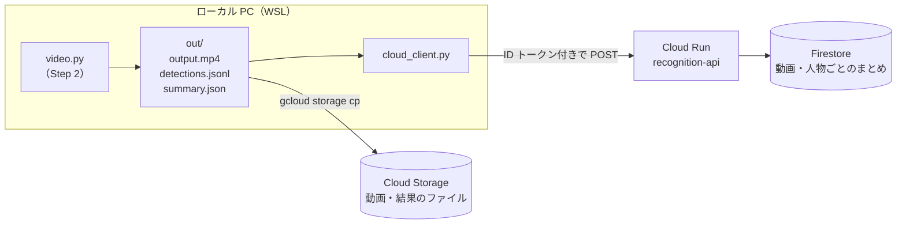

# Step 4 詳細手順：Google Cloud に結果を保存する

[[image-video-recognition-google-cloud-handson]] の Step 4 を、普段 Python や Google Cloud を使わない人でも進められるように詳しく書いた手順書です。[[image-video-recognition-step3-person-analysis]]（Step 3）までが終わっていることが前提です。

## 0. この手順書について

### このステップで作るもの

ここから Google Cloud を使います。AI の処理はまだローカル PC（WSL）で行い、**結果だけをクラウドに保存**します。



| サービス      | 作るもの                     | 入れるもの                                                 |
| ------------- | ---------------------------- | ---------------------------------------------------------- |
| Cloud Storage | バケット（ファイルの置き場） | 元の動画、枠付きの動画、`detections.jsonl`、`summary.json` |
| Firestore     | データベース                 | 動画ごと・人物ごとのまとめ（`summary.json` の中身）        |
| Cloud Run     | API（認証あり）              | `summary.json` を受け取り、Firestore に保存するプログラム  |

### かかる時間

| 作業                                 | 目安     |
| ------------------------------------ | -------- |
| Google Cloud の準備（第2章）         | 1時間    |
| Cloud Storage・Firestore（第3〜4章） | 30分     |
| API を作ってデプロイする（第5章）    | 1〜2時間 |
| ローカルから送る・確かめる（第6章）  | 30分     |

### 前提

- Step 1〜3 が終わっていて、`~/dev/image-recognition-handson/out/` に Step 2 の結果（`output.mp4`・`detections.jsonl`・`summary.json`）があること
- Google アカウントと、課金に使うクレジットカードなどがあること（課金の設定は、自分で Google Cloud Console の画面から行います）
- コマンドは、これまでと同じく **Ubuntu のターミナル**（行頭が `ユーザー名@PC名:`）で実行すること

### 費用の目安

このステップで使う量は少なく、ほとんどが各サービスの無料枠に収まります。ただし、無料枠を超えた分や、無料枠の無い部分には料金がかかります。必ず 2-1 で**予算アラート**を設定してから進めます。料金は変わるので、公式の料金ページで確認してください。

### このステップの作り方と、その理由

| 作り方                                                                                                    | 理由                                                                                                                                      |
| --------------------------------------------------------------------------------------------------------- | ----------------------------------------------------------------------------------------------------------------------------------------- |
| Firestore には**人物ごとのまとめだけ**を入れ、フレームごとの細かいデータは Cloud Storage にファイルで置く | Firestore は書き込みの件数で課金されます。Step 2 のサンプル動画でも、フレームごとだと 4,499 件、まとめなら 32 件（動画1件＋人物31件）です |
| API は**認証あり**で公開する                                                                              | 誰でもデータを書き込める API にしないためです。呼べるのは、許可したアカウントだけです                                                     |
| **サービスアカウントの鍵（JSON ファイル）を作らない**                                                     | 鍵ファイルは漏れると誰でも使えてしまいます。ローカルでは自分のログイン、クラウドではサービスに付けたアカウントを使います                  |
| API には、必要な権限（Firestore の読み書き）だけを持つ**専用のアカウント**を付ける                        | 万一 API が悪用されても、できることを最小限にするためです                                                                                 |
| API が受け取る項目と値の範囲を決め、それ以外は受け付けない                                                | 想定外のデータ（余計な項目、長すぎる ID など）を保存しないためです                                                                        |
| バケットは**非公開**にし、30日で自動削除する                                                              | 人が写った動画を置くためです（計画の第3章 3-1「使う映像のルール」）                                                                       |
| リージョンは**東京**（`asia-northeast1`）にそろえる                                                       | 人物の映像を国内に置くためです                                                                                                            |
| API は本体とは別のフォルダ（`api/`）・別の uv プロジェクトにする                                          | API には AI のライブラリ（PyTorch など）が不要です。API のイメージを小さく保てます                                                        |
| デプロイする前に、手元のテストで API の動きを確かめる                                                     | クラウドに上げてから間違いに気づくより、早く・安く直せます                                                                                |

### セキュリティの考え方

このステップは、インターネットに公開する API を作ります。どの対策をどこで行っているかを、まとめておきます。

| 対策                                 | このステップでの扱い                                                                                                                                 |
| ------------------------------------ | ---------------------------------------------------------------------------------------------------------------------------------------------------- |
| 認証（誰が呼んだか）                 | Cloud Run の機能で、ID トークンの無い呼び出しを拒否する（5-7）。プログラムの中で認証を作らない                                                       |
| 認可（呼んでよい人か）               | Cloud Run の「起動元」（`roles/run.invoker`）を持つアカウントだけが呼べる。いまは自分（プロジェクトのオーナー）だけ。Step 6 で VM のアカウントを足す |
| 秘密情報                             | 鍵ファイル・パスワードを作らない。ID トークンは画面やファイルに残さない                                                                              |
| 入力のチェック                       | 受け取る項目を決め、それ以外の項目・範囲外の値は拒否する（5-2）                                                                                      |
| ログ                                 | 受け取ったデータ（人物に関する情報）をログに出さない                                                                                                 |
| 通信                                 | Cloud Run の URL は HTTPS だけ                                                                                                                       |
| 費用の上限                           | API の同時に動く数を2までにする（`--max-instances=2`）。予算アラートを設定する                                                                       |
| ブラウザ向けの対策（CORS・CSP など） | この API はブラウザから呼ばないので、設定しない。説明のページ（`/docs`）も公開しない                                                                 |
| 呼び出し回数の制限                   | 呼べるのは許可したアカウントだけなので、このハンズオンでは設けない                                                                                   |

## 1. 用語

| 用語                                        | 意味                                                                                                                           |
| ------------------------------------------- | ------------------------------------------------------------------------------------------------------------------------------ |
| プロジェクト                                | Google Cloud でリソース（バケット・API など）と課金をまとめる単位。プロジェクト ID（例：`recognition-handson-1234`）で区別する |
| リージョン                                  | データセンターの場所。東京は `asia-northeast1`                                                                                 |
| バケット                                    | Cloud Storage のファイルの置き場。名前は世界で1つだけ                                                                          |
| コレクション・ドキュメント                  | Firestore のデータの入れ物。コレクション（フォルダのようなもの）の中にドキュメント（1件のデータ）が入る                        |
| サービスアカウント                          | 人ではなく、プログラム（API や VM）が使う Google Cloud のアカウント                                                            |
| ロール                                      | 「Firestore を読み書きできる」などの権限のまとまり。アカウントに付けて使う                                                     |
| ADC（アプリケーションのデフォルト認証情報） | ローカルの Python プログラムが Google Cloud を使うときの、自分のログイン情報                                                   |
| ID トークン                                 | 「このアカウントからの呼び出しです」と証明する、有効期限1時間の文字列。API を呼ぶときに付ける                                  |
| デプロイ                                    | プログラムをクラウドに置いて、動く状態にすること                                                                               |

## 2. Google Cloud の準備

### 2-1. プロジェクトを作り、課金と予算アラートを設定する（ブラウザで行う）

1. ブラウザで Google Cloud Console（`https://console.cloud.google.com/`）を開き、Google アカウントでログインする
2. 画面上部のプロジェクトの選択から「新しいプロジェクト」を選び、プロジェクトを作る
   - プロジェクト名：例 `recognition-handson`
   - プロジェクト ID：自動で付く ID（例：`recognition-handson-482917`）を**メモする**。あとのコマンドで使う
3. 「お支払い」で、課金アカウントをこのプロジェクトに紐付ける（課金アカウントが無ければ、画面の案内に沿って作る。クレジットカードなどの入力は自分で行う）
4. 「お支払い」→「予算とアラート」で予算を作る
   - 対象：このプロジェクト
   - 金額：例 月 3,000 円
   - アラート：50%・90%・100% で自分にメール
   - 予算アラートは**通知だけ**で、利用を自動で止めるものではありません

ハンズオン専用のプロジェクトを作っておくと、Step 8 の後片付けでプロジェクトごと削除できて確実です。

### 2-2. Google Cloud CLI（gcloud）を WSL に入れる

`gcloud` は、Google Cloud をコマンドで操作するツールです。プロジェクトのある **WSL の Ubuntu** に入れます（Windows 側に入れても、WSL からは使いません）。公式ドキュメントの「Debian / Ubuntu」の手順です。

```bash
sudo apt-get update
sudo apt-get install -y apt-transport-https ca-certificates gnupg curl
curl https://packages.cloud.google.com/apt/doc/apt-key.gpg | sudo gpg --dearmor -o /usr/share/keyrings/cloud.google.gpg
echo "deb [signed-by=/usr/share/keyrings/cloud.google.gpg] https://packages.cloud.google.com/apt cloud-sdk main" | sudo tee /etc/apt/sources.list.d/google-cloud-sdk.list
sudo apt-get update
sudo apt-get install -y google-cloud-cli
gcloud --version
```

`Google Cloud SDK 5xx.x.x` のように版が表示されれば成功です。

### 2-3. よく使う値を、ファイルにまとめておく

このあと、プロジェクト ID やバケット名を何度も使います。毎回打つと間違えやすいので、ファイルにまとめておき、ターミナルを開くたびに読み込みます。

```bash
cd ~/dev/image-recognition-handson
cat > cloud-env.sh <<'EOF'
# Google Cloud で使う値（ターミナルを開くたびに source cloud-env.sh で読み込む）
export PROJECT_ID="ここに2-1でメモしたプロジェクトID"
export REGION="asia-northeast1"
export BUCKET="gs://${PROJECT_ID}-recognition-data"
EOF
```

VS Code などで `cloud-env.sh` を開き、`PROJECT_ID` の値を自分のプロジェクト ID に書き換えて保存します。そのあと読み込み、正しく入ったかを確かめます。

```bash
source cloud-env.sh
echo $PROJECT_ID $REGION $BUCKET
```

**ターミナルを開き直したときは、最初に `cd ~/dev/image-recognition-handson` と `source cloud-env.sh` を実行します。** これを忘れると、コマンドの `$PROJECT_ID` などが空になり、エラーになります。

このファイルにはパスワードなどの秘密情報は入っていないので、Git に記録して構いません。

### 2-4. gcloud にログインする

```bash
gcloud init
```

- 「ログインしますか」と聞かれたら `Y` を押す。URL が表示されるか、ブラウザが開く
- ブラウザで Google アカウントを選び、許可する。表示された確認コードを、ターミナルに貼り付ける
- 「使うプロジェクトを選ぶ」と聞かれたら、2-1 で作ったプロジェクトを選ぶ
- 「既定のリージョン・ゾーンを設定しますか」と聞かれたら、`n` で構わない（コマンドごとに指定する）

次に、ローカルの Python プログラム（`cloud_client.py` など）が使うログイン情報（ADC）を作ります。

```bash
gcloud auth application-default login
gcloud auth application-default set-quota-project $PROJECT_ID
gcloud config set project $PROJECT_ID
```

ブラウザが開かない、または URL を開いてもうまくいかない場合は、`--no-launch-browser` を付けて実行し、表示された URL を Windows のブラウザに貼り付けます（例：`gcloud auth application-default login --no-launch-browser`）。

> **サービスアカウントの鍵（JSON ファイル）は作りません**
> インターネットの記事では、「サービスアカウントの鍵をダウンロードして `GOOGLE_APPLICATION_CREDENTIALS` に設定する」方法がよく紹介されています。鍵ファイルは、漏れると誰でもそのアカウントとして操作できてしまうため、このハンズオンでは使いません。ローカルでは上の ADC、クラウドではサービスに付けたアカウントを使います。

### 2-5. 使うサービス（API）を有効にする

Google Cloud のサービスは、使う前に有効にする必要があります。このハンズオン（Step 4〜7）で使うものを、まとめて有効にします。数分かかることがあります。

```bash
gcloud services enable \
  run.googleapis.com \
  firestore.googleapis.com \
  storage.googleapis.com \
  artifactregistry.googleapis.com \
  cloudbuild.googleapis.com \
  compute.googleapis.com \
  videointelligence.googleapis.com
```

| サービス                            | 使う Step                        |
| ----------------------------------- | -------------------------------- |
| Cloud Run・Firestore・Cloud Storage | Step 4                           |
| Artifact Registry・Cloud Build      | Step 4（API のデプロイ）・Step 6 |
| Video Intelligence API              | Step 5                           |
| Compute Engine                      | Step 6・7                        |

### 2-6. Cloud Build の権限を設定する

5-8 の `gcloud run deploy --source` と、Step 6 の `gcloud builds submit` は、裏で **Cloud Build**（クラウドで Docker イメージを作るサービス）を使います。権限は、ビルドを頼む人と、ビルドを実行するサービスアカウントの2か所に必要です。

| 誰に                               | ロール                                                        | 用途                                           |
| ---------------------------------- | ------------------------------------------------------------- | ---------------------------------------------- |
| ビルドを頼むユーザー               | Cloud Build 編集者（`roles/cloudbuild.builds.editor`）        | ビルドの作成・実行                             |
| ビルドを実行するサービスアカウント | Artifact Registry 書き込み（`roles/artifactregistry.writer`） | Docker イメージの保存                          |
| 同上                               | ログ書き込み（`roles/logging.logWriter`）                     | ビルドのログの出力                             |
| 同上                               | Storage バケット閲覧者（`roles/storage.bucketViewer`）        | ビルド用のバケットの参照                       |
| 同上                               | Storage オブジェクト ユーザー（`roles/storage.objectUser`）   | ビルド用のバケットへのソースのアップロードなど |

プロジェクトのオーナー（2-1 でプロジェクトを作った自分）は、ユーザー側の権限を最初から持っています。オーナーでない人がビルドするときだけ、Cloud Build 編集者を付けます。

新しいプロジェクトでは、ビルドを実行するのは Compute Engine の既定のサービスアカウント（`プロジェクト番号-compute@developer.gserviceaccount.com`）です。このアカウントに4つのロールを付けます。

```bash
PROJECT_NUMBER=$(gcloud projects describe $PROJECT_ID --format='value(projectNumber)')
BUILD_SA="serviceAccount:${PROJECT_NUMBER}-compute@developer.gserviceaccount.com"

for ROLE in \
  roles/artifactregistry.writer \
  roles/logging.logWriter \
  roles/storage.bucketViewer \
  roles/storage.objectUser; do
  gcloud projects add-iam-policy-binding $PROJECT_ID --member="$BUILD_SA" --role="$ROLE" --condition=None
done
```

`--condition=None` は、「条件付きの権限（期限付きなど）にしない」という指定です。付けないと、条件を付けるかを聞かれることがあります。

プロジェクト全体に付けるため、このサービスアカウントは、認識結果のバケットを含むすべてのバケットのファイルを読み書きできるようになります。ハンズオン専用のプロジェクトなら、これで構いません。業務で使うときは、ビルド専用のサービスアカウントを作り、Storage のロールはビルド用のバケットにだけ付けます。

Step 6 の VM には、この既定のアカウントではなく、専用のサービスアカウントを付けます。そうすれば、上の権限が VM に渡ることはありません。

## 3. Cloud Storage にファイルを保存する

### 3-1. バケットを作る

```bash
gcloud storage buckets create $BUCKET \
  --location=$REGION \
  --uniform-bucket-level-access \
  --public-access-prevention
```

| オプション                      | 意味                                                                               |
| ------------------------------- | ---------------------------------------------------------------------------------- |
| `--location=$REGION`            | 東京に作る                                                                         |
| `--uniform-bucket-level-access` | 権限をバケット単位でまとめて管理する（ファイルごとに公開設定ができないようにする） |
| `--public-access-prevention`    | インターネットに公開する設定を、誤ってもできないようにする                         |

バケット名（`プロジェクトID-recognition-data`）が他の人と重なっているとエラーになります。その場合は `cloud-env.sh` の `BUCKET` の名前を変えて、`source cloud-env.sh` してからやり直します。

### 3-2. 30日で自動削除する設定にする

人が写った動画を置くので、置きっぱなしにしないよう、30日たったファイルを自動で削除する設定（ライフサイクル）を入れます。

```bash
cat > lifecycle.json <<'EOF'
{
  "rule": [
    { "action": { "type": "Delete" }, "condition": { "age": 30 } }
  ]
}
EOF

gcloud storage buckets update $BUCKET --lifecycle-file=lifecycle.json
gcloud storage buckets describe $BUCKET --format="yaml(lifecycle_config)"
```

最後のコマンドで、`age: 30` と `type: Delete` が表示されれば設定できています。

### 3-3. ローカルの結果をアップロードする

保存先は、次の形にそろえます。Step 6 の VM も同じ形で保存します。

```text
gs://プロジェクトID-recognition-data/
├── input/                 ← 処理する前の動画
│   └── sample.mp4
└── output/
    └── sample/            ← video_id（動画のファイル名から作る）
        ├── output.mp4
        ├── detections.jsonl
        └── summary.json
```

```bash
gcloud storage cp sample.mp4 $BUCKET/input/sample.mp4
gcloud storage cp out/output.mp4 out/detections.jsonl out/summary.json $BUCKET/output/sample/
gcloud storage ls --recursive $BUCKET
```

最後のコマンドで、4つのファイルが一覧に出れば成功です。Google Cloud Console の「Cloud Storage」→「バケット」からも、同じファイルを確かめられます。

> Step 3 で作った `out/analysis.json` や `out/analysis.mp4` は、ここではアップロードしません。アップロードするのは、Step 6 の VM が保存するのと同じ3つのファイルだけです。

## 4. Firestore を作る

### 4-1. データベースを作る

```bash
gcloud firestore databases create --location=$REGION
```

**ロケーションはあとから変更できません。** 東京（`asia-northeast1`）になっていることを確かめてから実行します。

### 4-2. データの持ち方

Firestore には、`summary.json` の中身を次の形で保存します。

```text
videos（コレクション）
└── sample（ドキュメント：動画1本につき1件。ID は video_id）
    ├── fps: 10.0
    ├── frame_count: 795
    ├── person_count: 31
    ├── created_at: 保存した日時（Timestamp 型）
    └── tracks（コレクション）
        ├── 1（ドキュメント：人物1人につき1件。ID は tracking_id）
        │   ├── tracking_id: 1
        │   ├── first_seen_sec: 0.0
        │   ├── last_seen_sec: 15.3
        │   ├── duration_sec: 15.4
        │   └── max_confidence: 0.892
        ├── 2
        └── …
```

サンプル動画なら、書き込みは32件（動画1件＋人物31件）です。フレームごとに書くと 4,499 件になり、Firestore の無料枠（1日2万件）を動画数本で使い切ってしまいます。フレームごとのデータを集計したくなったら、Firestore ではなく、Cloud Storage の `detections.jsonl` を BigQuery に読み込んで分析します。

## 5. API を作って、Cloud Run にデプロイする

### 5-1. API のプロジェクトを作る

プロジェクトの中に `api/` フォルダを作り、本体とは別の uv プロジェクトにします。

```bash
cd ~/dev/image-recognition-handson
mkdir api
cd api
uv init --app --no-package --no-workspace --python 3.13
uv add fastapi uvicorn google-cloud-firestore
uv add --dev pytest httpx
```

| 指定・ライブラリ             | 意味                                                                         |
| ---------------------------- | ---------------------------------------------------------------------------- |
| `--no-workspace`             | 付けないと、本体のプロジェクトの一部（ワークスペース）として登録されてしまう |
| `fastapi`                    | API を作るためのライブラリ                                                   |
| `uvicorn`                    | FastAPI のプログラムを、Web サーバーとして動かすもの                         |
| `google-cloud-firestore`     | Firestore に読み書きするライブラリ                                           |
| `pytest`・`httpx`（`--dev`） | 手元でテストするときだけ使う。Cloud Run には入れない                         |

### 5-2. main.py を書く

`api/main.py` を、次の内容で上書きします（`code main.py` で開けます）。

```python
"""認識結果のまとめ（summary.json）を受け取り、Firestore に保存する API。"""
from fastapi import FastAPI
from google.cloud import firestore
from pydantic import BaseModel, ConfigDict, Field

# 説明のページ（/docs など）は公開しない
app = FastAPI(docs_url=None, redoc_url=None, openapi_url=None)
db = firestore.Client()


class Track(BaseModel):
    """人物（追跡 ID）1人分のまとめ。"""
    model_config = ConfigDict(extra="forbid")  # 決めた項目以外は受け付けない

    tracking_id: int = Field(ge=0)
    first_seen_sec: float = Field(ge=0)
    last_seen_sec: float = Field(ge=0)
    duration_sec: float = Field(ge=0)
    max_confidence: float = Field(ge=0, le=1)


class VideoSummary(BaseModel):
    """動画1本分のまとめ（video.py が作る summary.json と同じ形）。"""
    model_config = ConfigDict(extra="forbid")

    video_id: str = Field(pattern=r"^[A-Za-z0-9_-]{1,64}$")
    fps: float = Field(gt=0, le=240)
    frame_count: int = Field(ge=0)
    person_tracks: list[Track] = Field(max_length=499)  # まとめて書ける上限は500件


@app.post("/summaries", status_code=201)
def create_summary(summary: VideoSummary) -> dict:
    """まとめを Firestore に保存する。同じ video_id なら上書きする。"""
    video_ref = db.collection("videos").document(summary.video_id)
    batch = db.batch()  # 全部まとめて書く（途中で失敗したら、どれも書かれない）
    batch.set(video_ref, {
        "fps": summary.fps,
        "frame_count": summary.frame_count,
        "person_count": len(summary.person_tracks),
        "created_at": firestore.SERVER_TIMESTAMP,
    })
    for track in summary.person_tracks:
        batch.set(video_ref.collection("tracks").document(str(track.tracking_id)), track.model_dump())
    batch.commit()
    # 受け取った中身はログに出さない（人物に関するデータのため）
    return {"video_id": summary.video_id, "tracks": len(summary.person_tracks)}
```

| 部分                                | していること                                                                              |
| ----------------------------------- | ----------------------------------------------------------------------------------------- |
| `FastAPI(docs_url=None, ...)`       | API を作る。説明のページ（`/docs` など）は公開しない                                      |
| `db = firestore.Client()`           | Firestore に接続する。接続に使うアカウントは、Cloud Run に付けたサービスアカウント（5-6） |
| `class Track`・`class VideoSummary` | 受け取るデータの形。項目の名前・型・値の範囲を決める。`summary.json` と同じ形             |
| `extra="forbid"`                    | 決めた項目以外が入っていたら、受け付けない                                                |
| `pattern=r"^[A-Za-z0-9_-]{1,64}$"`  | `video_id` に使える文字は英数字・`_`・`-` だけ、長さは64文字まで                          |
| `@app.post("/summaries")`           | `/summaries` に POST されたときに動く処理                                                 |
| `db.batch()` 〜 `batch.commit()`    | 動画1件と人物ごとの件数を、まとめて書き込む。途中で失敗したら、どれも書かれない           |

形が合わないデータを受け取ると、FastAPI が自動で `422`（データの形が正しくない）を返し、`create_summary()` は動きません。

### 5-3. 手元でテストする

デプロイする前に、決めた形のデータだけを受け付けるかを、本物の Firestore を使わずに確かめます。`api/test_main.py` を作ります。

```python
"""API が決めた形のデータだけを受け付けるかを、本物の Firestore を使わずに確かめるテスト。"""
import os

# 本物の Firestore に接続しないための設定（main を読み込む前に設定する）
os.environ.setdefault("GOOGLE_CLOUD_PROJECT", "local-test")
os.environ.setdefault("FIRESTORE_EMULATOR_HOST", "localhost:8999")

from fastapi.testclient import TestClient  # noqa: E402

import main  # noqa: E402


class FakeDocument:
    """Firestore の文書の代わり。書き込まれた場所（path）だけを覚える。"""
    def __init__(self, path: str):
        self.path = path

    def collection(self, name: str) -> "FakeCollection":
        return FakeCollection(f"{self.path}/{name}")


class FakeCollection:
    def __init__(self, path: str):
        self.path = path

    def document(self, doc_id: str) -> FakeDocument:
        return FakeDocument(f"{self.path}/{doc_id}")


class FakeBatch:
    def __init__(self, saved: dict):
        self.saved = saved
        self.pending: dict = {}

    def set(self, ref: FakeDocument, data: dict) -> None:
        self.pending[ref.path] = data

    def commit(self) -> None:
        self.saved.update(self.pending)


class FakeDB:
    """Firestore の代わり。保存したものを saved に入れる。"""
    def __init__(self):
        self.saved: dict = {}

    def collection(self, name: str) -> FakeCollection:
        return FakeCollection(name)

    def batch(self) -> FakeBatch:
        return FakeBatch(self.saved)


VALID = {
    "video_id": "sample",
    "fps": 10.0,
    "frame_count": 795,
    "person_tracks": [
        {"tracking_id": 1, "first_seen_sec": 0.0, "last_seen_sec": 15.3, "duration_sec": 15.4, "max_confidence": 0.892},
    ],
}


def make_client(monkeypatch) -> tuple[TestClient, FakeDB]:
    fake = FakeDB()
    monkeypatch.setattr(main, "db", fake)
    return TestClient(main.app), fake


def test_正しい形なら保存して201を返す(monkeypatch):
    client, fake = make_client(monkeypatch)
    response = client.post("/summaries", json=VALID)
    assert response.status_code == 201
    assert response.json() == {"video_id": "sample", "tracks": 1}
    assert "videos/sample" in fake.saved
    assert fake.saved["videos/sample/tracks/1"]["duration_sec"] == 15.4


def test_決めていない項目があれば受け付けない(monkeypatch):
    client, fake = make_client(monkeypatch)
    response = client.post("/summaries", json={**VALID, "is_admin": True})
    assert response.status_code == 422
    assert fake.saved == {}


def test_video_idに使えない文字があれば受け付けない(monkeypatch):
    client, fake = make_client(monkeypatch)
    response = client.post("/summaries", json={**VALID, "video_id": "../other"})
    assert response.status_code == 422
    assert fake.saved == {}


def test_信頼度が1を超えていれば受け付けない(monkeypatch):
    client, fake = make_client(monkeypatch)
    bad_track = {**VALID["person_tracks"][0], "max_confidence": 1.5}
    response = client.post("/summaries", json={**VALID, "person_tracks": [bad_track]})
    assert response.status_code == 422


def test_説明のページは公開しない(monkeypatch):
    client, _ = make_client(monkeypatch)
    assert client.get("/docs").status_code == 404
    assert client.get("/openapi.json").status_code == 404
```

`FakeDB` は、Firestore の代わりに、保存しようとしたデータを覚えておくだけの入れ物です。`monkeypatch.setattr(main, "db", fake)` で、`main.py` の `db` を一時的にこれに置き換えています。

```bash
uv run pytest
```

2026年11月に試したときは、次のように表示されました。

```text
test_main.py .....                                                       [100%]
...
========================= 5 passed, 1 warning in 4.08s =========================
```

5つのテストがすべて通りました（`5 passed`）。`1 warning` は、テストに使うライブラリの書き方が将来変わるという予告で、API の動きには関係ありません。

| テスト                                     | 確かめていること                                                      |
| ------------------------------------------ | --------------------------------------------------------------------- |
| 正しい形なら保存して201を返す              | `summary.json` と同じ形なら、動画1件と人物ごとのデータを保存する      |
| 決めていない項目があれば受け付けない       | `is_admin` のような余計な項目があれば、`422` で拒否し、何も保存しない |
| video_idに使えない文字があれば受け付けない | `../other` のような文字を拒否する                                     |
| 信頼度が1を超えていれば受け付けない        | 範囲外の値を拒否する                                                  |
| 説明のページは公開しない                   | `/docs` などが `404` になる                                           |

### 5-4. Dockerfile を書く

Cloud Run は、Docker イメージにしたプログラムを動かします。`api/Dockerfile` を作ります。

```dockerfile
FROM python:3.13-slim

# uv（ローカルと同じ版）
COPY --from=ghcr.io/astral-sh/uv:0.13.7 /uv /bin/uv

WORKDIR /app
ENV UV_LINK_MODE=copy UV_COMPILE_BYTECODE=1 UV_PYTHON_DOWNLOADS=never UV_NO_CACHE=1

# ライブラリは uv.lock に書かれた版どおりに入れる（開発用の pytest などは入れない）
COPY pyproject.toml uv.lock .python-version ./
RUN uv sync --frozen --no-dev --no-install-project

COPY main.py ./

# 管理者ではない利用者で動かす
RUN useradd --create-home appuser
USER appuser
ENV PATH="/app/.venv/bin:$PATH"

# Cloud Run が渡すポート番号（PORT）で待ち受ける
CMD ["sh", "-c", "uvicorn main:app --host 0.0.0.0 --port ${PORT:-8080}"]
```

| 行                                            | 意味                                                                                                   |
| --------------------------------------------- | ------------------------------------------------------------------------------------------------------ |
| `FROM python:3.13-slim`                       | Python 3.13 が入った小さな Linux（Debian）から始める。`.python-version` の版と同じにする               |
| `COPY --from=ghcr.io/astral-sh/uv:0.13.7 ...` | uv を入れる。版はローカルの `uv --version` と同じにする。古いと `uv.lock` を読めずに失敗することがある |
| `ENV ... UV_NO_CACHE=1`                       | uv の設定。Python はイメージに入っているものを使い、ダウンロードしたファイルの控えをイメージに残さない |
| `uv sync --frozen --no-dev`                   | `uv.lock` に書かれた版どおりにライブラリを入れる。開発用（pytest など）は入れない                      |
| `useradd` ・ `USER appuser`                   | 管理者（root）ではない利用者で動かす                                                                   |
| `CMD [... uvicorn ...]`                       | Cloud Run が決めるポート番号（環境変数 `PORT`）で、API を待ち受ける                                    |

### 5-5. アップロードしないファイルを決める

デプロイのときは、`api/` フォルダの中身をクラウドにアップロードしてからイメージを作ります。手元の仮想環境（`.venv`）などは送らないように、`api/.gcloudignore` と `api/.dockerignore` を作ります。

```bash
printf '.venv/\n__pycache__/\n.pytest_cache/\n' > .gcloudignore
cp .gcloudignore .dockerignore
```

### 5-6. API 専用のサービスアカウントを作る

API が Firestore を読み書きするためのアカウントを作り、Firestore の読み書き（`roles/datastore.user`）だけを付けます。

```bash
gcloud iam service-accounts create recognition-api --display-name="recognition API"

gcloud projects add-iam-policy-binding $PROJECT_ID \
  --member="serviceAccount:recognition-api@${PROJECT_ID}.iam.gserviceaccount.com" \
  --role="roles/datastore.user" \
  --condition=None
```

### 5-7. デプロイする

`api/` フォルダの中で実行します。

```bash
gcloud run deploy recognition-api \
  --source=. \
  --region=$REGION \
  --service-account="recognition-api@${PROJECT_ID}.iam.gserviceaccount.com" \
  --no-allow-unauthenticated \
  --max-instances=2
```

| オプション                   | 意味                                                                                                    |
| ---------------------------- | ------------------------------------------------------------------------------------------------------- |
| `--source=.`                 | 今いるフォルダ（`api/`）の中身と Dockerfile から、イメージを作ってデプロイする                          |
| `--service-account=...`      | API が動くときに使うアカウント（5-6）                                                                   |
| `--no-allow-unauthenticated` | **認証なしの呼び出しを拒否する**。呼べるのは「起動元」（`roles/run.invoker`）の権限を持つアカウントだけ |
| `--max-instances=2`          | 同時に動く数を2までにする（使いすぎ・費用の上限）                                                       |

初めてのときは、「ソースのイメージを置くリポジトリ（`cloud-run-source-deploy`）を作りますか」と聞かれるので、`Y` を押します。イメージを作るので、数分かかります。最後に次のように表示されれば成功です。

```text
Service [recognition-api] revision [recognition-api-00001-xxx] has been deployed and is serving 100 percent of traffic.
Service URL: https://recognition-api-xxxxxxxxxx.asia-northeast1.run.app
```

### 5-8. 認証なしでは呼べないことを確かめる

```bash
cd ~/dev/image-recognition-handson
export API_URL=$(gcloud run services describe recognition-api --region=$REGION --format='value(status.url)')
echo $API_URL

# ID トークンを付けずに呼ぶ → 403（拒否）になる
curl -s -o /dev/null -w "%{http_code}\n" -X POST "$API_URL/summaries"
```

`403` と表示されれば、認証なしの呼び出しが拒否されています。`200` や `422` が表示された場合は、認証なしで呼べる状態になっています。5-7 の `--no-allow-unauthenticated` を確かめて、デプロイし直します。

## 6. ローカルから結果を送る

### 6-1. 送るためのライブラリを入れる

本体のプロジェクト（`~/dev/image-recognition-handson`）に戻り、ライブラリを追加します。

```bash
cd ~/dev/image-recognition-handson
uv add google-auth requests google-cloud-storage
```

| ライブラリ             | 役割                                   | 使う場所               |
| ---------------------- | -------------------------------------- | ---------------------- |
| `google-auth`          | ID トークンを取る                      | `cloud_client.py`      |
| `requests`             | API を呼ぶ                             | `cloud_client.py`      |
| `google-cloud-storage` | Cloud Storage のファイルを読み書きする | Step 6 の `run_job.py` |

### 6-2. cloud_client.py を書く

`summary.json` を読んで、API に送るプログラムです。Step 6 では、VM の中でも同じファイルを使います。

```python
"""認識結果のまとめ（summary.json）を Cloud Run の API に送る。"""
import json
import os
import sys
from pathlib import Path

import google.auth.transport.requests
import google.oauth2.id_token
import requests


def get_id_token(audience: str) -> str:
    """API を呼ぶための ID トークンを用意する。"""
    # ローカル：gcloud auth print-identity-token で取った値を、環境変数 ID_TOKEN に入れておく
    token = os.environ.get("ID_TOKEN")
    if token:
        return token
    # VM（コンテナ）：VM に付けたサービスアカウントで ID トークンを取る
    return google.oauth2.id_token.fetch_id_token(google.auth.transport.requests.Request(), audience)


def send_summary(api_url: str, summary_path: Path) -> None:
    """summary.json を読み、API に POST する。"""
    summary = json.loads(Path(summary_path).read_text(encoding="utf-8"))
    response = requests.post(
        f"{api_url}/summaries",
        json=summary,
        headers={"Authorization": f"Bearer {get_id_token(api_url)}"},
        timeout=30,
    )
    response.raise_for_status()  # 200 番台以外ならエラーにする
    print(response.json())


if __name__ == "__main__":
    if len(sys.argv) != 2:
        raise SystemExit("使い方: uv run python cloud_client.py out/summary.json")
    send_summary(os.environ["API_URL"], Path(sys.argv[1]))
```

| 部分                 | していること                                                                                           |
| -------------------- | ------------------------------------------------------------------------------------------------------ |
| `get_id_token()`     | ID トークンを用意する。ローカルでは環境変数 `ID_TOKEN` の値を使い、VM では VM に付けたアカウントで取る |
| `send_summary()`     | `summary.json` を読み、`Authorization: Bearer ID トークン` を付けて `/summaries` に POST する          |
| `raise_for_status()` | 失敗（`403`・`422`・`500` など）なら、エラーにして止める                                               |

### 6-3. 送る

```bash
export ID_TOKEN=$(gcloud auth print-identity-token)
uv run python cloud_client.py out/summary.json
```

次のように表示されれば成功です（`tracks` の数は、自分の `summary.json` の人数）。

```text
{'video_id': 'sample', 'tracks': 31}
```

- `gcloud auth print-identity-token` は、自分のアカウントの ID トークンを取ります。プロジェクトのオーナーは、この API を呼ぶ権限を持っています
- ID トークンの有効期限は約1時間です。時間がたって `403` になったら、`export ID_TOKEN=...` の行をもう一度実行します
- トークンは、画面に表示したりファイルに保存したりしないようにします（`echo $ID_TOKEN` もしない）

### 6-4. Firestore に入ったことを確かめる

Google Cloud Console の「Firestore」→「データ」を開き、`videos` → `sample` → `tracks` と順に開きます。`summary.json` と同じ値が入っていることを確かめます。

### 6-5. 正しくないデータが拒否されることを確かめる

決めていない項目を付けて送ると、API が `422` で拒否することを、クラウドの API でも確かめます。

```bash
curl -s -w "\n%{http_code}\n" -X POST "$API_URL/summaries" \
  -H "Authorization: Bearer $ID_TOKEN" \
  -H "Content-Type: application/json" \
  -d '{"video_id": "sample", "fps": 10, "frame_count": 1, "person_tracks": [], "is_admin": true}'
```

最後の行に `422` が表示され、その前に `is_admin` が許されていない（`extra_forbidden`）という内容が表示されれば、正しく拒否されています。Firestore のデータも変わりません。

## 7. うまくいかないとき

| 症状                                                                                                  | 原因と対処                                                                                                                                                                                 |
| ----------------------------------------------------------------------------------------------------- | ------------------------------------------------------------------------------------------------------------------------------------------------------------------------------------------ |
| コマンドに `$PROJECT_ID` などを使うと、`argument --project: expected one argument` などのエラーになる | `cloud-env.sh` を読み込んでいない。`cd ~/dev/image-recognition-handson` と `source cloud-env.sh` を実行する                                                                                |
| `gcloud: command not found`                                                                           | 2-2 のインストールが終わっていない。最後の `sudo apt-get install -y google-cloud-cli` を確かめる                                                                                           |
| ログインの URL を開いても、ブラウザでエラーになる                                                     | `--no-launch-browser` を付けて実行し、表示された URL を Windows のブラウザに貼り付ける                                                                                                     |
| `API [xxx.googleapis.com] not enabled`                                                                | 2-5 のサービスの有効化が終わっていない。もう一度実行して、数分待つ                                                                                                                         |
| `Billing account ... is not found` や `billing is not enabled`                                        | 2-1 の課金の紐付けができていない                                                                                                                                                           |
| バケットの作成で `409` や `already exists`                                                            | バケット名が他の人と重なっている。`cloud-env.sh` の `BUCKET` を変える                                                                                                                      |
| デプロイで `PERMISSION_DENIED` や、ビルドの失敗                                                       | 2-6 の Cloud Build の権限が足りない。エラーに出ているロールを確かめて付ける                                                                                                                |
| デプロイで `uv.lock` を読めない、`failed to parse`                                                    | Dockerfile の uv の版（`uv:0.13.7`）が、ローカルの `uv --version` より古い。同じ版に書き換える                                                                                             |
| `cloud_client.py` で `403 Forbidden`                                                                  | ID トークンが無い・期限切れ、または呼ぶ権限が無い。`export ID_TOKEN=$(gcloud auth print-identity-token)` をやり直す                                                                        |
| `cloud_client.py` で `422 Unprocessable`                                                              | `summary.json` の形が API の決まりと合わない。`video.py` を書き換えていないか、`person_tracks` が499件を超えていないかを確かめる                                                           |
| `cloud_client.py` で `500 Internal Server Error`                                                      | API から Firestore に書けていない。4-1 で Firestore を作ったか、5-6 で `roles/datastore.user` を付けたかを確かめる。Console の「Cloud Run」→`recognition-api`→「ログ」でエラーの内容を見る |
| `KeyError: 'API_URL'`                                                                                 | 環境変数 `API_URL` が無い。5-8 の `export API_URL=...` を実行する                                                                                                                          |

## 8. 完了条件

- [ ] 予算アラートを設定した
- [ ] バケットが非公開で、30日で削除する設定になっている
- [ ] バケットの `input/` に元の動画、`output/sample/` に結果の3つのファイルがある
- [ ] 手元のテスト（`uv run pytest`）がすべて通った
- [ ] ID トークンを付けずに API を呼ぶと `403` で拒否される
- [ ] `cloud_client.py` で送ったまとめが、Firestore の `videos/sample` と、その下の `tracks` に入っている
- [ ] 決めていない項目を付けたデータが `422` で拒否される

## 9. このあとの Step とのつながり

Step 4 が終わった時点で、プロジェクトのフォルダには次のファイルが増えています。

```text
~/dev/image-recognition-handson/
├── cloud-env.sh        ← プロジェクト ID などの値
├── lifecycle.json      ← 30日で削除する設定
├── cloud_client.py     ← まとめを API に送る（Step 6 でも使う）
├── api/                ← Cloud Run の API
│   ├── main.py
│   ├── test_main.py
│   ├── Dockerfile
│   ├── .dockerignore
│   ├── .gcloudignore
│   ├── pyproject.toml
│   ├── uv.lock
│   └── .python-version
└── （Step 1〜3 のファイル）
```

区切りとして、Git に記録します。

```bash
cd ~/dev/image-recognition-handson
git add cloud-env.sh lifecycle.json cloud_client.py pyproject.toml uv.lock api/
git status
git commit -m "Step 4: 結果を Cloud Storage と Firestore に保存する"
```

`git status` で、`api/.venv/` が記録の対象に入っていないことを確かめてから、`git commit` します。入っている場合は、プロジェクトの `.gitignore` に `.venv/` が書かれているかを確かめます。

| Step 4 で用意したもの                                          | 使う Step | 使い方                                                                     |
| -------------------------------------------------------------- | --------- | -------------------------------------------------------------------------- |
| `cloud-env.sh`                                                 | Step 5〜8 | ターミナルを開くたびに `source cloud-env.sh` で読み込む                    |
| バケットの `input/sample.mp4`                                  | Step 5・6 | Video Intelligence API と、VM の処理の入力にする                           |
| `cloud_client.py`                                              | Step 6    | VM の中で、まとめを API に送る                                             |
| `google-cloud-storage`                                         | Step 6    | VM の中で、動画の取得と結果の保存に使う                                    |
| API と専用のサービスアカウント                                 | Step 6    | VM のサービスアカウントに「起動元」の権限を足して、VM から呼べるようにする |
| Cloud Build の権限                                             | Step 6・7 | VM で動かす Docker イメージを作る                                          |
| Dockerfile の書き方（uv の版・`--no-dev`・管理者でない利用者） | Step 6    | 認識処理のイメージも同じ考え方で作る                                       |
| 作ったリソース                                                 | Step 8    | 後片付けで削除する                                                         |

次は Step 5「Google の認識 API と比べる」に進みます。
