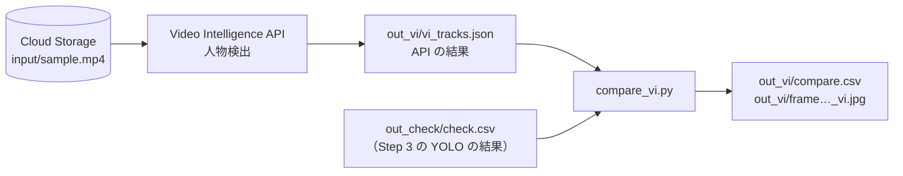

# Step 5 詳細手順：Google の認識 API と比べる

[[image-video-recognition-google-cloud-handson]] の Step 5 を、普段 Python や Google Cloud を使わない人でも進められるように詳しく書いた手順書です。[[image-video-recognition-step4-cloud-storage-api]]（Step 4）までが終わっていることが前提です。

## 0. この手順書について

### このステップでやること

ここまでは、自分で YOLO を動かして人物を検出してきました。Google Cloud には、動画を渡すだけで人物を検出してくれる **Video Intelligence API** もあります。同じサンプル動画を API にかけ、Step 3 で精度を確かめたのと同じフレームで、YOLO と結果を並べて比べます。



### かかる時間

| 作業                               | 目安                                  |
| ---------------------------------- | ------------------------------------- |
| 準備・プログラムの作成（第2〜3章） | 30分                                  |
| API で処理する（第4章）            | 10〜20分（ほとんどが API の処理待ち） |
| 結果を比べて表にまとめる（第5章）  | 1時間                                 |

### 前提

- Step 4 が終わっていて、バケットの `input/sample.mp4` に Step 2 のサンプル動画があること
- Step 3 の `check_frames.py` を、今の `sample.mp4` で実行して、`out_check/check.csv` があること。Step 3 の 6-4 で、`actual`（実際の人数）などを書き込んでいれば、なおよい
- ターミナルを開いたら、最初に `cd ~/dev/image-recognition-handson` と `source cloud-env.sh` を実行すること（Step 4 の 2-3）

### 注意：動画が国外で処理される

**Video Intelligence API は東京リージョンに対応していないため、動画は国外で処理されます。** バケットが東京にあっても、API が処理するときに動画が国外に渡ります。

- このステップでは、公開されているサンプル動画（OpenCV の `vtest.avi` を変換したもの）だけを使います
- 自分や同僚を録画した動画は、API にかけません（計画の第3章 3-1・3-3）

### 費用について

Video Intelligence API は、**処理した動画の長さ（分）で課金**されます。毎月一定の時間までは無料ですが、使う機能や量によって料金がかかります。料金は変わるので、公式の料金ページで確認してください。

このステップのプログラムは、API の結果をファイル（`out_vi/vi_tracks.json`）に保存し、2回目からは API を呼ばずにそのファイルを使えるようにしています。**API を呼ぶのは最初の1回だけ**にします。

### このステップの作り方と、その理由

| 作り方                                                   | 理由                                                                             |
| -------------------------------------------------------- | -------------------------------------------------------------------------------- |
| Step 3 の `check_frames.py` と**同じフレーム**で比べる   | 同じ画像を見比べることで、どちらが見落とし・誤検出をしたかを、目で確かめられます |
| API の結果をファイルに保存し、2回目からは API を呼ばない | 動画の長さで課金されるためです。比べ方を変えて何度も試せます                     |
| API の枠を画像に描いて保存する                           | Step 3 の `frame…_conf0.4.jpg`（YOLO）と並べて見られます                         |
| ライブラリは `--dev` で入れる                            | 比べるのは手元だけです。Step 6 で VM に載せる Docker イメージには入れません      |

## 1. Google の画像・動画の認識 API

| API                    | できること                                                             | このステップ                                   |
| ---------------------- | ---------------------------------------------------------------------- | ---------------------------------------------- |
| Video Intelligence API | 動画の人物検出と追跡、顔の検出、物体の追跡、ラベル付けなど             | 人物検出を使う                                 |
| Vision API             | 画像（1枚）の物体検出（`Person` を返す）、顔の検出、文字の読み取りなど | 使わない（画像だけなら、こちらでも比べられる） |

どちらの API も、顔の**検出**（どこに顔があるか）まではしますが、**本人の特定**（誰の顔か）はしません。本人の特定は、計画の第6章（追加課題）の内容です。

自分で動かす YOLO と、Google の API の違いは、次のとおりです。

|              | 自分で動かす YOLO                                        | Video Intelligence API               |
| ------------ | -------------------------------------------------------- | ------------------------------------ |
| どこで動くか | 自分の PC や VM                                          | Google のサーバー（東京以外）        |
| 準備         | Python・ライブラリ・モデル・VM の用意が必要              | API を有効にして、呼ぶだけ           |
| 処理の中身   | 自分で選べる・変えられる（モデル、しきい値、追跡の方法） | 選べない（Google が決めたモデル）    |
| 結果の使い方 | 線を越えた人数などを、その場で自由に計算できる           | 結果を受け取ってから、自分で計算する |
| 費用         | PC は無料。VM は動かしている時間で課金                   | 処理した動画の長さで課金             |

## 2. 準備する

### 2-1. ライブラリを入れる

```bash
cd ~/dev/image-recognition-handson
source cloud-env.sh
uv add --dev google-cloud-videointelligence
```

`--dev` は「開発のときだけ使う」という指定です。Step 6 の Docker イメージは `uv sync --no-dev` で作るので、このライブラリはイメージに入りません。

API を呼ぶときは、Step 4 の 2-4 で作ったログイン情報（ADC）が使われます。

### 2-2. 比べるフレームを用意する

Step 3 の `check_frames.py` を、今の `sample.mp4` で実行していなければ、実行しておきます（実行済みなら不要です）。

```bash
uv run python check_frames.py --source sample.mp4
```

`out_check/check.csv` に、取り出したフレームの番号・時刻と、YOLO が検出した人数が入ります。

## 3. compare_vi.py を作る

VS Code で `compare_vi.py` を作り、次の内容を保存します（`code compare_vi.py` で開けます）。

```python
"""Video Intelligence API で人物を検出し、YOLO（Step 3 の check_frames.py）の結果と並べて比べる。"""
import argparse
import csv
import json
from pathlib import Path

import cv2
from google.cloud import videointelligence


def detect_people(input_uri: str):
    """Video Intelligence API に、Cloud Storage の動画の人物検出を頼み、結果を待つ。"""
    client = videointelligence.VideoIntelligenceServiceClient()
    config = videointelligence.PersonDetectionConfig(
        include_bounding_boxes=True,   # 人物の枠を返してもらう
        include_attributes=False,      # 服装などの特徴は使わない
        include_pose_landmarks=False,  # 関節の位置は使わない
    )
    operation = client.annotate_video(
        request={
            "features": [videointelligence.Feature.PERSON_DETECTION],
            "input_uri": input_uri,
            "video_context": videointelligence.VideoContext(person_detection_config=config),
        }
    )
    print("Video Intelligence API で処理しています（数分かかることがあります）…")
    return operation.result(timeout=900).annotation_results[0]


def to_tracks(annotation) -> list[dict]:
    """API の結果を、人物（追跡）ごとの単純な辞書の一覧にする。"""
    tracks = []
    for person in annotation.person_detection_annotations:
        for track in person.tracks:
            boxes = []
            for obj in track.timestamped_objects:
                b = obj.normalized_bounding_box  # 位置は 0〜1 の割合で返ってくる
                boxes.append({"sec": round(obj.time_offset.total_seconds(), 2),
                              "box": [b.left, b.top, b.right, b.bottom]})
            tracks.append({
                "start_sec": round(track.segment.start_time_offset.total_seconds(), 2),
                "end_sec": round(track.segment.end_time_offset.total_seconds(), 2),
                "confidence": round(track.confidence, 3),
                "boxes": boxes,
            })
    return tracks


def boxes_at(tracks: list[dict], sec: float, tolerance: float = 0.5) -> list[list[float]]:
    """sec 秒の時点に映っている人物の枠を、追跡ごとに1つずつ返す。"""
    found = []
    for track in tracks:
        if not track["boxes"] or not (track["start_sec"] - tolerance <= sec <= track["end_sec"] + tolerance):
            continue
        nearest = min(track["boxes"], key=lambda b: abs(b["sec"] - sec))
        if abs(nearest["sec"] - sec) <= tolerance:
            found.append(nearest["box"])
    return found


def main() -> None:
    parser = argparse.ArgumentParser(description="Video Intelligence API と YOLO の人物検出を比べる")
    parser.add_argument("--input-uri", help="Cloud Storage の動画（gs://...）。API を呼ぶときに指定する")
    parser.add_argument("--from-json", help="前に保存した結果（vi_tracks.json）を使う。API は呼ばない")
    parser.add_argument("--source", default="sample.mp4", help="同じ動画のローカルのファイル（枠を描くため）")
    parser.add_argument("--check", default="out_check/check.csv", help="Step 3 の check_frames.py が作った表")
    parser.add_argument("--out-dir", default="out_vi", help="結果の保存先フォルダ")
    args = parser.parse_args()

    out_dir = Path(args.out_dir)
    out_dir.mkdir(parents=True, exist_ok=True)
    tracks_path = out_dir / "vi_tracks.json"

    # ① API を呼ぶ（または、前に保存した結果を読む）
    if args.from_json:
        tracks = json.loads(Path(args.from_json).read_text(encoding="utf-8"))
    elif args.input_uri:
        tracks = to_tracks(detect_people(args.input_uri))
        tracks_path.write_text(json.dumps(tracks, ensure_ascii=False), encoding="utf-8")
        print(f"保存しました: {tracks_path}（次からは --from-json {tracks_path} で、API を呼ばずに使えます）")
    else:
        raise SystemExit("--input-uri gs://... か --from-json out_vi/vi_tracks.json のどちらかを指定します")
    print(f"Video Intelligence API が見つけた人物（追跡）の数: {len(tracks)}")

    # ② Step 3 と同じフレームで、YOLO（conf 0.4）と人数を比べ、API の枠を画像に描く
    with open(args.check, encoding="utf-8-sig", errors="replace") as f:
        check_rows = list(csv.DictReader(f))
    cap = cv2.VideoCapture(args.source)
    if not cap.isOpened():
        raise SystemExit(f"映像を開けません: {args.source}")
    width = cap.get(cv2.CAP_PROP_FRAME_WIDTH)
    height = cap.get(cv2.CAP_PROP_FRAME_HEIGHT)

    rows = []
    print("フレーム    秒  YOLO(conf0.4)  Video Intelligence")
    for row in check_rows:
        frame_number, sec = int(row["frame"]), float(row["seconds"])
        boxes = boxes_at(tracks, sec)
        cap.set(cv2.CAP_PROP_POS_FRAMES, frame_number)
        ok, frame = cap.read()
        if ok:
            for left, top, right, bottom in boxes:  # 割合をピクセルに直して描く
                cv2.rectangle(frame, (int(left * width), int(top * height)),
                              (int(right * width), int(bottom * height)), (255, 128, 0), 2)
            cv2.putText(frame, f"Video Intelligence: {len(boxes)}", (10, 30),
                        cv2.FONT_HERSHEY_SIMPLEX, 0.8, (255, 128, 0), 2)
            cv2.imwrite(str(out_dir / f"frame{frame_number:05d}_vi.jpg"), frame)
        yolo = row.get("detected_conf0.4", "")
        rows.append([frame_number, sec, yolo, len(boxes), row.get("actual", "")])
        print(f"{frame_number:>6}  {sec:>5}  {yolo:>13}  {len(boxes):>18}")
    cap.release()

    with open(out_dir / "compare.csv", "w", newline="", encoding="utf-8-sig") as f:
        writer = csv.writer(f)
        writer.writerow(["frame", "seconds", "yolo_conf0.4", "video_intelligence", "actual"])
        writer.writerows(rows)
    print(f"保存しました: {out_dir}（compare.csv と、API の枠を描いた画像 {len(rows)} 枚）")


if __name__ == "__main__":
    main()
```

### プログラムの読み方

| 部分                         | していること                                                                                                                               |
| ---------------------------- | ------------------------------------------------------------------------------------------------------------------------------------------ |
| `detect_people()`            | Cloud Storage の動画の人物検出を、Video Intelligence API に頼み、終わるまで待つ                                                            |
| `PersonDetectionConfig(...)` | 人物の枠を返してもらう。服装などの特徴・関節の位置は使わない                                                                               |
| `to_tracks()`                | API の結果を、人物（追跡）ごとの「いつからいつまで・どの位置にいたか」の一覧にする。位置は、画面の幅と高さに対する割合（0〜1）で返ってくる |
| `boxes_at()`                 | 指定した時刻に映っている人物の枠を、追跡ごとに1つずつ取り出す                                                                              |
| `main()` の ①                | API を呼ぶ（`--input-uri`）か、前に保存した結果を読む（`--from-json`）                                                                     |
| `main()` の ②                | `check.csv` のフレームごとに、YOLO と API の人数を並べて表示し、API の枠を描いた画像と `compare.csv` を保存する                            |

#### 主なオプション

| オプション    | 意味                                                                     |
| ------------- | ------------------------------------------------------------------------ |
| `--input-uri` | API にかける動画（`gs://...`）。最初の1回だけ使う                        |
| `--from-json` | 前に保存した API の結果（`out_vi/vi_tracks.json`）を使う。API は呼ばない |
| `--source`    | 同じ動画のローカルのファイル（枠を描くため。初期値 `sample.mp4`）        |
| `--check`     | Step 3 の表（初期値 `out_check/check.csv`）                              |
| `--out-dir`   | 結果の保存先（初期値 `out_vi`）                                          |

## 4. 実行する

### 4-1. API で処理する（最初の1回だけ）

```bash
time uv run python compare_vi.py --input-uri $BUCKET/input/sample.mp4
```

`Video Intelligence API で処理しています…` と表示されてから、結果が返るまで数分かかります。終わると、次のような形で表示されます（人数は実際の結果によって変わります）。

```text
保存しました: out_vi/vi_tracks.json（次からは --from-json out_vi/vi_tracks.json で、API を呼ばずに使えます）
Video Intelligence API が見つけた人物（追跡）の数: （人数）
フレーム    秒  YOLO(conf0.4)  Video Intelligence
     0    0.0              3   （人数）
    79    7.9              6   （人数）
   …
保存しました: out_vi（compare.csv と、API の枠を描いた画像 10 枚）
```

最後に表示される `real` が、API に頼んでから結果を受け取るまでの時間です。メモしておきます（第5章の表で使います）。

### 4-2. 2回目からは API を呼ばない

比べ方を変えて実行し直すときは、保存した結果を使います。料金はかかりません。

```bash
uv run python compare_vi.py --from-json out_vi/vi_tracks.json
```

Step 3 の 6-4 で `check.csv` に `actual`（実際の人数）を書き込んだあとに実行すると、`compare.csv` にもその人数が入ります。

## 5. 結果を比べる

### 5-1. 同じフレームの画像を並べて見る

```bash
explorer.exe .
```

同じフレーム番号の、次の2枚を並べて見ます。

| ファイル                           | 中身                                              |
| ---------------------------------- | ------------------------------------------------- |
| `out_check/frame00159_conf0.4.jpg` | YOLO（conf 0.4）の検出結果（青い枠）              |
| `out_vi/frame00159_vi.jpg`         | Video Intelligence API の検出結果（オレンジの枠） |

Step 3 の 6-4 で確かめた「柱の陰に半分隠れた人」「遠くの小さい人」を、API は見つけたかを確かめます。

### 5-2. フレームごとの人数を比べる

`out_vi/compare.csv` を Excel で開くと、フレームごとに次の列が並んでいます。

| 列                   | 中身                                              |
| -------------------- | ------------------------------------------------- |
| `yolo_conf0.4`       | YOLO（conf 0.4）が検出した人数                    |
| `video_intelligence` | API が検出した人数                                |
| `actual`             | Step 3 で目で数えた実際の人数（書き込んでいれば） |

フレームごとに、見落とし（実際の人数より少ない）と誤検出（人でないものの枠がある）を、画像を見ながら数えます。

### 5-3. 比べた結果を表にまとめる

| 項目                           | 自分で動かす YOLO                                  | Video Intelligence API         |
| ------------------------------ | -------------------------------------------------- | ------------------------------ |
| 見つけた人物（追跡）の数       | （Step 2 の `summary.json`。サンプル動画では 31）  | （4-1 の結果）                 |
| 10フレームの見落としの合計     | （Step 3 の 6-6）                                  |                                |
| 10フレームの誤検出の合計       | （Step 3 の 6-6）                                  |                                |
| 80秒の動画の処理時間           | （Step 2 の 6-3。サンプル動画では約1分）           | （4-1 の `real`）              |
| 80秒の動画の料金               | ローカル PC なら無料。VM の料金は Step 6・7 で計算 | （公式の料金表から計算）       |
| 線を越えた人数などの独自の処理 | Step 3 のように自由に作れる                        | 結果を受け取ってから自分で作る |
| 準備の手間                     | 環境・モデル・VM の管理が必要                      | API を呼ぶだけ                 |
| 動画を処理する場所             | 自分の PC・東京の VM                               | 国外                           |

最後に、次の2つを自分の言葉でまとめます。

- 精度・速さ・費用・手間・データの置き場所を考えると、**どちらを選ぶか**、またそれはどんな場合か
- 例：「人が写った社内の映像を国外に出せないなら YOLO」「まずは手間をかけず試したいなら API」

## 6. うまくいかないとき

| 症状                                                | 原因と対処                                                                                                                                 |
| --------------------------------------------------- | ------------------------------------------------------------------------------------------------------------------------------------------ |
| `403` や `PERMISSION_DENIED`（`videointelligence`） | Step 4 の 2-5 で Video Intelligence API を有効にしていない。`gcloud services enable videointelligence.googleapis.com` を実行して、数分待つ |
| `403`（`storage`）や、動画を読めないというエラー    | 動画の場所（`gs://...`）が違う。`gcloud storage ls $BUCKET/input/` で `sample.mp4` があるかを確かめる                                      |
| `Could not automatically determine credentials`     | ログイン情報（ADC）が無い。Step 4 の 2-4 の `gcloud auth application-default login` をやり直す                                             |
| `quota project` についての警告やエラー              | `gcloud auth application-default set-quota-project $PROJECT_ID` を実行する                                                                 |
| `--input-uri` が `gs:///input/...` のようになる     | `source cloud-env.sh` を忘れている。`$BUCKET` が空になっている                                                                             |
| `FileNotFoundError: out_check/check.csv`            | Step 3 の `check_frames.py` を実行していない。2-2 を実行する                                                                               |
| API の人数がすべて 0                                | 時刻の合わせ方の問題の可能性がある。`out_vi/vi_tracks.json` を開き、`sec` の値が動画の秒数（0〜80）になっているかを確かめる                |
| `TimeoutError` や、処理が終わらない                 | API の処理に時間がかかっている。もう一度実行すると、また課金されるので注意する。Google Cloud Console で API の利用状況を確かめる           |

## 7. 完了条件

- [ ] Video Intelligence API で、サンプル動画の人物検出ができた（`out_vi/vi_tracks.json` がある）
- [ ] 同じフレームの YOLO と API の画像を並べて、違いを確かめた
- [ ] 5-3 の表を埋め、「どちらを選ぶか」を自分の言葉で説明できる
- [ ] 国外で処理される API に、自分や同僚を録画した動画を渡していない

## 8. このあとの Step とのつながり

Step 5 が終わった時点で、プロジェクトのフォルダには次のファイルが増えています。

```text
~/dev/image-recognition-handson/
├── compare_vi.py       ← Video Intelligence API と比べる
├── out_vi/             ← 結果（Git には入らない）
│   ├── vi_tracks.json
│   ├── compare.csv
│   └── frame…_vi.jpg
└── （Step 1〜4 のファイル）
```

`out_vi/` は `.gitignore` に入っていないので、記録の対象から外します。

```bash
echo "out_vi/" >> .gitignore
git add .gitignore compare_vi.py pyproject.toml uv.lock
git commit -m "Step 5: Video Intelligence API と比べる"
```

| Step 5 で分かったこと  | 使う Step   | 使い方                                                                  |
| ---------------------- | ----------- | ----------------------------------------------------------------------- |
| API の処理時間・料金   | Step 6・7   | 自分の VM（CPU・GPU）で処理したときの時間・料金と比べる                 |
| API の精度             | Step 7      | GPU で大きなモデルを動かすと、どこまで API に近づくかを考える材料にする |
| データの置き場所の違い | 計画の第6章 | 顔などの個人を特定できる情報を扱うときの判断の材料にする                |

次は Step 6「AI の処理を Compute Engine 上で実行する」に進みます。
