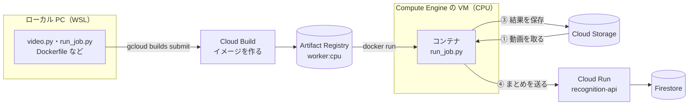

# Step 6 詳細手順：AI の処理を Compute Engine 上で実行する

[[image-video-recognition-google-cloud-handson]] の Step 6 を、普段 Python や Google Cloud を使わない人でも進められるように詳しく書いた手順書です。[[image-video-recognition-step4-cloud-storage-api]]（Step 4）までが終わっていることが前提です（Step 5 は終わっていなくても進められます）。

## 0. この手順書について

### このステップで作るもの

ここまでローカル PC（WSL）で動かしてきた認識処理（`video.py`）を **Docker イメージ**にまとめ、Google Cloud の仮想マシン（**Compute Engine の VM**）で動かします。VM は、Cloud Storage から動画を取ってきて認識し、結果を Cloud Storage に保存して、まとめを Step 4 の API に送ります。



`run_job.py` の ② で、Step 2 と同じ `video.py` を使って認識します。

### かかる時間

| 作業                                       | 目安                                   |
| ------------------------------------------ | -------------------------------------- |
| プログラムと Dockerfile の作成（第2〜3章） | 30分                                   |
| ローカルでイメージを試す（第4章）          | 30分（初回はイメージの作成に10分ほど） |
| クラウドでイメージを作る（第5章）          | 20分                                   |
| VM を作って動かす（第6〜7章）              | 1時間                                  |

### 前提

- Step 4 が終わっていて、バケット・API（`recognition-api`）・`cloud_client.py` があること
- プロジェクトのフォルダの一番上に、Step 1 でダウンロードした `yolo11n.pt` があること
- ターミナルを開いたら、最初に `cd ~/dev/image-recognition-handson` と `source cloud-env.sh` を実行すること

### 費用について

VM は、**動かしている時間で課金**されます。このステップで使う `e2-standard-4`（CPU 4つ・メモリ 16GB）は、動かしたままにすると1か月で数千円以上になります。**使い終わったら、すぐに削除します**（第8章）。停止しただけでは、ディスクの料金がかかり続けます。

### このステップの作り方と、その理由

| 作り方                                                            | 理由                                                                                                                                       |
| ----------------------------------------------------------------- | ------------------------------------------------------------------------------------------------------------------------------------------ |
| ローカルと同じ `uv.lock`・`.python-version` でイメージを作る      | ローカルと全く同じ版の Python・ライブラリ（CPU 版の PyTorch を含む）が入ります。「ローカルでは動いたのに、クラウドでは動かない」を防ぎます |
| AI モデル（`yolo11n.pt`）とフォントをイメージに含める             | 実行のたびにダウンロードしなくて済みます。インターネットにつながらない場所でも動きます                                                     |
| Ultralytics の利用状況の送信を、イメージの中でも止めておく        | ローカル（Step 1）と同じ設定にするためです                                                                                                 |
| 管理者（root）ではない利用者で動かす                              | 万一プログラムが乗っ取られても、できることを減らすためです                                                                                 |
| クラウドに送る前に、**WSL の Docker でイメージを試す**            | クラウドで失敗するより、早く・安く直せます                                                                                                 |
| イメージは Cloud Build で作る                                     | 1.5GB ほどある重いイメージを、自分の PC からアップロードせずに済みます                                                                     |
| VM には、必要な権限だけを持つ**専用のサービスアカウント**を付ける | このバケットの読み書き、この API の呼び出し、このイメージの取得だけができるようにします                                                    |
| 鍵ファイルを使わない                                              | VM の中のプログラムは、VM に付けたアカウントで Google Cloud を使います                                                                     |
| VM の OS は Container-Optimized OS にする                         | Docker が最初から入っていて、コンテナを動かすためだけの小さく安全な OS です                                                                |

## 1. 用語

| 用語                   | 意味                                                                                 |
| ---------------------- | ------------------------------------------------------------------------------------ |
| Docker イメージ        | プログラム・ライブラリ・設定を1つにまとめたもの。どこでも同じように動く              |
| コンテナ               | イメージを動かしている状態のもの                                                     |
| Dockerfile             | イメージの作り方を書いたファイル                                                     |
| Artifact Registry      | Google Cloud の、Docker イメージの置き場                                             |
| Cloud Build            | Google Cloud の、イメージを作るサービス                                              |
| VM（仮想マシン）       | クラウドの上に作るコンピュータ。Compute Engine で作る                                |
| Container-Optimized OS | Google が用意した、コンテナを動かすための OS                                         |
| タグ                   | イメージに付ける名前の一部（`worker:cpu` の `cpu`）。Step 7 では `worker:gpu` を作る |

## 2. VM で動かすプログラムを作る

### 2-1. run_job.py を作る

プロジェクトのフォルダに `run_job.py` を作ります。VM のコンテナの中で動き、次の4つを順に行います。

```python
"""Cloud Storage の動画を認識し、結果を Cloud Storage と API に送る（VM のコンテナの中で実行）。"""
import os
import sys
from pathlib import Path

from google.cloud import storage

from cloud_client import send_summary
from video import make_video_id, run


def main() -> None:
    if len(sys.argv) != 2 or not sys.argv[1].startswith("gs://"):
        raise SystemExit("使い方: run_job.py gs://バケット名/input/動画.mp4")
    bucket_name, blob_name = sys.argv[1].removeprefix("gs://").split("/", 1)
    bucket = storage.Client().bucket(bucket_name)

    # ① Cloud Storage から動画を取ってくる
    work = Path("/tmp/work")
    work.mkdir(parents=True, exist_ok=True)
    local_video = work / Path(blob_name).name
    bucket.blob(blob_name).download_to_filename(str(local_video))
    print(f"動画を取得しました: {sys.argv[1]}")

    # ② Step 2 と同じ video.py で認識する（画面表示なし）
    out_dir = work / "out"
    summary_path = run(str(local_video), out_dir)
    print("認識が終わりました")

    # ③ 結果のファイルを Cloud Storage に保存する
    prefix = f"output/{make_video_id(str(local_video))}"
    for name in ("output.mp4", "detections.jsonl", "summary.json"):
        bucket.blob(f"{prefix}/{name}").upload_from_filename(str(out_dir / name))
    print(f"結果を保存しました: gs://{bucket_name}/{prefix}/")

    # ④ まとめを API に送り、Firestore に保存してもらう
    send_summary(os.environ["API_URL"], summary_path)


if __name__ == "__main__":
    main()
```

| 部分 | していること                                                                                                             |
| ---- | ------------------------------------------------------------------------------------------------------------------------ |
| ①    | `gs://バケット名/input/動画.mp4` の形で指定された動画を、Cloud Storage からコンテナの中（`/tmp/work`）にダウンロードする |
| ②    | Step 2 の `video.py` の `run()` で認識する。画面表示はしない                                                             |
| ③    | 結果の3つのファイルを、Cloud Storage の `output/動画のID/` に保存する。Step 4 の 3-3 と同じ置き方                        |
| ④    | Step 4 の `cloud_client.py` で、まとめを API に送る。ID トークンは、VM に付けたアカウントで取る                          |

`video.py` と `cloud_client.py` は書き換えずに、そのまま使います。

### 2-2. VM の中で使うライブラリ

Step 4 の 6-1 で `google-cloud-storage`・`google-auth`・`requests` を本体のプロジェクトに追加しているので、追加の作業はありません。`pyproject.toml` に入っていることを確かめます。

```bash
grep -E "google-cloud-storage|google-auth|requests" pyproject.toml
```

## 3. Dockerfile を書く

### 3-1. Dockerfile

プロジェクトのフォルダの一番上に `Dockerfile` を作ります。

```dockerfile
FROM python:3.13-slim

# uv（ローカルと同じ版）
COPY --from=ghcr.io/astral-sh/uv:0.13.7 /uv /bin/uv

# OpenCV が使うライブラリ
RUN apt-get update \
    && apt-get install -y --no-install-recommends libgl1 libglib2.0-0 \
    && rm -rf /var/lib/apt/lists/*

WORKDIR /app
ENV UV_LINK_MODE=copy UV_COMPILE_BYTECODE=1 UV_PYTHON_DOWNLOADS=never UV_NO_CACHE=1

# ライブラリは uv.lock に書かれた版どおりに入れる（開発用の pytest などは入れない）
COPY pyproject.toml uv.lock .python-version ./
RUN uv sync --frozen --no-dev --no-install-project

# プログラムと AI モデル（モデルはイメージに含め、実行のたびにダウンロードしない）
COPY video.py cloud_client.py run_job.py yolo11n.pt ./

# 管理者ではない利用者で動かす
RUN useradd --create-home appuser
USER appuser
ENV PATH="/app/.venv/bin:$PATH"

# Ultralytics の初期設定：利用状況の送信を止め、枠のラベルを描くフォントを用意しておく
RUN python -c "from ultralytics import settings; settings.update({'sync': False}); from ultralytics.utils.checks import check_font; check_font('Arial.ttf')"

ENTRYPOINT ["python", "run_job.py"]
```

| 行                                                       | 意味                                                                                                                                                          |
| -------------------------------------------------------- | ------------------------------------------------------------------------------------------------------------------------------------------------------------- |
| `FROM python:3.13-slim`                                  | Python 3.13 の入った小さな Linux（Debian）から始める。`.python-version` と同じ版                                                                              |
| `COPY --from=ghcr.io/astral-sh/uv:0.13.7 ...`            | uv を入れる。ローカルの `uv --version` と同じ版にする                                                                                                         |
| `apt-get install ... libgl1 libglib2.0-0`                | OpenCV が使う部品。Step 1 の 1-2 で WSL に入れたものと同じ                                                                                                    |
| `ENV ... UV_PYTHON_DOWNLOADS=never UV_NO_CACHE=1`        | uv の設定。Python はイメージに入っているものを使い、ダウンロードしたファイルの控えをイメージに残さない（残すと約1.5GB 大きくなる）                            |
| `uv sync --frozen --no-dev --no-install-project`         | `uv.lock` に書かれた版どおりにライブラリを入れる。CPU 版の PyTorch も、Step 1 の設定どおりに入る。開発用（pytest・Video Intelligence のライブラリ）は入れない |
| `COPY video.py cloud_client.py run_job.py yolo11n.pt ./` | 必要なプログラムとモデルだけを入れる。Step 3・5 のプログラムは入れない                                                                                        |
| `useradd` ・ `USER appuser`                              | 管理者ではない利用者で動かす                                                                                                                                  |
| `RUN python -c "..."`                                    | Ultralytics の利用状況の送信を止め、枠のラベルを描くフォント（`Arial.ttf`）を先にダウンロードしておく                                                         |
| `ENTRYPOINT ["python", "run_job.py"]`                    | コンテナを動かすと、`run_job.py` が動く。`docker run` の最後に書いた値（`gs://...`）が、そのまま `run_job.py` に渡る                                          |

### 3-2. イメージに入れないファイルを決める

イメージを作るときには、プロジェクトのフォルダの中身が Docker（ローカル）や Cloud Build（クラウド）に送られます。人が写った動画や、大きな仮想環境（`.venv`）を送らないように、送らないファイルを2つのファイルに書きます。

| ファイル        | 使われる場面                               |
| --------------- | ------------------------------------------ |
| `.dockerignore` | ローカルの `docker build`（第4章）         |
| `.gcloudignore` | クラウドの `gcloud builds submit`（第5章） |

`.dockerignore` を次の内容で作ります。

```text
# 仮想環境・Git の記録・API（別のイメージ）
.venv/
.git/
api/
__pycache__/
.pytest_cache/

# 動画・画像・結果（人が写るため、アップロードしない）
*.mp4
*.avi
*.mov
*.jpg
*.png
*.csv
out/
out_*/

# 使わないモデル（yolo11n.pt はイメージに含めるので書かない）
yolo11n-pose.pt
yolo11s.pt

# 秘密情報
.env
```

同じ内容で `.gcloudignore` を作ります。

```bash
cp .dockerignore .gcloudignore
```

> **`.gcloudignore` は必ず作る**
> `.gcloudignore` が無いと、`gcloud` は代わりに `.gitignore` を使います。`.gitignore` には Step 1 で `*.pt` を書いたので、`yolo11n.pt` が送られず、イメージを作るときに `yolo11n.pt` が見つからずに失敗します。

## 4. ローカルの WSL でイメージを試す

クラウドに送る前に、WSL の Docker でイメージを作って試します。WSL に Docker が入っていない場合は、この章を飛ばして第5章に進んでも構いません（クラウドで失敗したときに、原因を探しにくくなります）。

### 4-1. Docker が使えるかを確かめる

```bash
docker version --format '{{.Server.Version}}'
```

版（例：`29.5.3`）が表示されれば使えます。`permission denied` になる場合は、自分のアカウントが `docker` グループに入っていません。`sudo usermod -aG docker $USER` を実行し、Ubuntu のターミナルを開き直します（PowerShell で `wsl --shutdown` を実行してから開き直すと確実です）。

### 4-2. イメージを作る

```bash
time docker build -t recognition-worker:cpu .
docker images recognition-worker:cpu
```

2026年11月に試したときは、約1分15秒でイメージができました（ライブラリのダウンロードを含む。2回目からは、変更の無い部分が使い回されるので速くなります）。

```text
IMAGE                    ID             DISK USAGE   CONTENT SIZE   EXTRA
recognition-worker:cpu   615079929c24       2.71GB          607MB
```

`DISK USAGE`（2.71GB）が手元のディスクで使う大きさ、`CONTENT SIZE`（607MB）が圧縮した大きさです。ほとんどが PyTorch と OpenCV です。

> **イメージが 4GB 以上になったら**
> Dockerfile の `ENV` の行に `UV_NO_CACHE=1` が入っているかを確かめます。これが無いと、uv がダウンロードしたファイルの控え（約1.5GB）が、イメージの中に残ってしまいます。

### 4-3. コンテナの中で video.py を動かす

`run_job.py` は Cloud Storage を使うので、ローカルではそのまま動かせません。代わりに、同じイメージの中で `video.py` だけを動かし、認識処理が動くことを確かめます。

```bash
mkdir -p out_docker
time docker run --rm --network none \
  -v "$PWD/sample.mp4:/data/sample.mp4:ro" \
  -v "$PWD/out_docker:/data/out" \
  --entrypoint python \
  recognition-worker:cpu video.py --source /data/sample.mp4 --out-dir /data/out
```

| オプション                             | 意味                                                                                               |
| -------------------------------------- | -------------------------------------------------------------------------------------------------- |
| `--rm`                                 | 終わったらコンテナを消す                                                                           |
| `--network none`                       | インターネットにつながない状態で動かす。モデルやフォントのダウンロードが要らないことを確かめるため |
| `-v 手元のパス:コンテナの中のパス`     | 手元のファイル・フォルダを、コンテナの中から使えるようにする（`:ro` は読むだけ）                   |
| `--entrypoint python ... video.py ...` | `run_job.py` の代わりに、`video.py` を動かす                                                       |

```text
保存しました: /data/out/summary.json

real	0m32.353s
```

インターネットにつながない状態でも、約30秒で処理が終わりました。モデルとフォントがイメージに入っているので、ダウンロードは要りません。

`out_docker/` に、Step 2 と同じ3つのファイルができます。`out_docker/summary.json` の `person_tracks` の数を、ローカルの `out/summary.json` と比べます。

```bash
uv run python -c "import json; print(len(json.load(open('out/summary.json'))['person_tracks']), len(json.load(open('out_docker/summary.json'))['person_tracks']))"
```

```text
31 31
```

ローカルとコンテナで、同じ31の ID が記録されました。同じ版の Python・ライブラリ・モデルを使っているので、同じ結果になります。

### 4-4. コンテナの中の設定を確かめる

```bash
docker run --rm --entrypoint sh recognition-worker:cpu -c 'whoami; ls ~/.config/Ultralytics; grep -o "\"sync\": [a-z]*" ~/.config/Ultralytics/settings.json'
```

```text
appuser
Arial.ttf
settings.json
"sync": false
```

| 表示            | 意味                                             |
| --------------- | ------------------------------------------------ |
| `appuser`       | 管理者ではない利用者で動いている                 |
| `Arial.ttf`     | 枠のラベルを描くフォントが、イメージに入っている |
| `"sync": false` | Ultralytics の利用状況の送信が止まっている       |

試し終わったら、`out_docker/` は削除して構いません（`rm -r out_docker`）。

## 5. クラウドでイメージを作る

### 5-1. イメージの置き場を作る

```bash
gcloud artifacts repositories create recognition \
  --repository-format=docker \
  --location=$REGION \
  --description="認識処理のイメージ"
```

### 5-2. Cloud Build でイメージを作る

```bash
export IMAGE="${REGION}-docker.pkg.dev/${PROJECT_ID}/recognition/worker"
echo $IMAGE

time gcloud builds submit --tag="${IMAGE}:cpu" .
```

- プロジェクトのフォルダ（`.gcloudignore` に書いたものを除く）が Cloud Build に送られ、クラウドで `Dockerfile` のとおりにイメージが作られて、Artifact Registry に保存されます
- 初回は10〜20分ほどかかります。最後に `STATUS` が `SUCCESS` と表示されれば成功です
- `IMAGE` も、ターミナルを開き直すと消えます。`cloud-env.sh` の最後に `export IMAGE="${REGION}-docker.pkg.dev/${PROJECT_ID}/recognition/worker"` を書き足しておくと便利です

作ったイメージを確かめます。

```bash
gcloud artifacts docker images list ${REGION}-docker.pkg.dev/${PROJECT_ID}/recognition
```

## 6. VM の準備をする

### 6-1. VM 専用のサービスアカウントを作る

VM の中のプログラムが使うアカウントを作り、必要な権限だけを、必要な場所にだけ付けます。

```bash
gcloud iam service-accounts create recognition-worker --display-name="recognition worker VM"
export WORKER_SA="recognition-worker@${PROJECT_ID}.iam.gserviceaccount.com"

# このバケットのファイルの読み書きだけ
gcloud storage buckets add-iam-policy-binding $BUCKET \
  --member="serviceAccount:${WORKER_SA}" --role="roles/storage.objectUser"

# この API の呼び出しだけ
gcloud run services add-iam-policy-binding recognition-api \
  --region=$REGION --member="serviceAccount:${WORKER_SA}" --role="roles/run.invoker"

# このリポジトリのイメージの取得だけ
gcloud artifacts repositories add-iam-policy-binding recognition \
  --location=$REGION --member="serviceAccount:${WORKER_SA}" --role="roles/artifactregistry.reader"
```

| 付けたロール                  | 付けた場所                   | できること             |
| ----------------------------- | ---------------------------- | ---------------------- |
| Storage オブジェクト ユーザー | このバケットだけ             | 動画の取得・結果の保存 |
| Cloud Run 起動元              | `recognition-api` だけ       | API を呼ぶ             |
| Artifact Registry 読み取り    | `recognition` リポジトリだけ | イメージを取ってくる   |

プロジェクト全体ではなく、使う場所にだけ権限を付けているのがポイントです。この VM からは、他のバケットのファイルを読んだり、Firestore に直接書き込んだりはできません。

### 6-2. VM で処理する動画を用意する

Step 4 でアップロードした `sample.mp4` を VM で処理すると、`output/sample/` と Firestore の `videos/sample` が上書きされ、ローカルの結果と区別できなくなります。VM 用に、名前を変えたコピーを作ります。

```bash
gcloud storage cp $BUCKET/input/sample.mp4 $BUCKET/input/vm-test.mp4
```

VM の結果は、`output/vm-test/` と Firestore の `videos/vm-test` に入ります（`video_id` はファイル名から作られます）。

## 7. VM で動かす

### 7-1. VM を作る

```bash
gcloud compute instances create recognition-cpu \
  --zone=${REGION}-b \
  --machine-type=e2-standard-4 \
  --image-family=cos-stable \
  --image-project=cos-cloud \
  --service-account=$WORKER_SA \
  --scopes=cloud-platform
```

| オプション                                                 | 意味                                                                                         |
| ---------------------------------------------------------- | -------------------------------------------------------------------------------------------- |
| `--zone=asia-northeast1-b`                                 | 東京の b ゾーンに作る                                                                        |
| `--machine-type=e2-standard-4`                             | CPU 4つ・メモリ 16GB                                                                         |
| `--image-family=cos-stable` ・ `--image-project=cos-cloud` | OS は Container-Optimized OS（Docker 入り）                                                  |
| `--service-account=$WORKER_SA`                             | 6-1 で作った専用のアカウントを付ける                                                         |
| `--scopes=cloud-platform`                                  | 使える範囲は、アカウントに付けたロールで決める（ロールで絞っているので、ここは広くしてよい） |

### 7-2. API の URL をメモする

VM の中では `cloud-env.sh` も gcloud も使えないので、API の URL を手元でメモしておきます。

```bash
gcloud run services describe recognition-api --region=$REGION --format='value(status.url)'
echo "${IMAGE}:cpu"
echo "${BUCKET}/input/vm-test.mp4"
```

表示された3つの値（API の URL・イメージの名前・動画の場所）を、メモ帳などにコピーしておきます。

### 7-3. VM にログインする

```bash
gcloud compute ssh recognition-cpu --zone=${REGION}-b
```

初めてのときは、SSH の鍵を作るかを聞かれます。Enter を押して進めます（パスフレーズは空のままで構いません）。行頭が `ユーザー名@recognition-cpu` に変われば、VM にログインできています。

### 7-4. VM の中でコンテナを動かす

ここからは **VM の中**で実行します。`<…>` の部分は、7-2 でメモした値に置き換えます。

```bash
# Artifact Registry からイメージを取れるようにする（VM に付けたアカウントを使う）
docker-credential-gcr configure-docker --registries=asia-northeast1-docker.pkg.dev

# 動かす（1回目は、イメージのダウンロードに数分かかる）
time docker run --rm \
  -e API_URL=<API の URL> \
  <イメージの名前（…/worker:cpu）> \
  <動画の場所（gs://…/input/vm-test.mp4）>
```

次のように表示されれば成功です。

```text
動画を取得しました: gs://…/input/vm-test.mp4
認識が終わりました
結果を保存しました: gs://…/output/vm-test/
{'video_id': 'vm-test', 'tracks': 31}
```

最後に表示される `real` が、VM での処理時間です。**メモしておきます**（Step 7 で GPU と比べます）。ただし、1回目はイメージのダウンロードの時間も含まれます。処理だけの時間を測るには、同じコマンドをもう一度実行します。

終わったら、VM からログアウトします。

```bash
exit
```

### 7-5. 結果を確かめる

手元の WSL に戻って確かめます。

```bash
gcloud storage ls $BUCKET/output/vm-test/
```

- Cloud Storage：`output/vm-test/` に3つのファイルがある
- Firestore：Google Cloud Console の「Firestore」→「データ」で、`videos` の下に `vm-test` がある

## 8. VM を削除する

処理時間をメモしたら、VM は**すぐに削除**します。Step 7 では、別の VM（GPU 付き）を作ります。

```bash
gcloud compute instances delete recognition-cpu --zone=${REGION}-b
```

`Do you want to continue (Y/n)?` と聞かれたら `Y` を押します。VM を作り直すのは、7-1 のコマンドですぐにできます。イメージ・バケット・API は残しておきます（Step 7・8 で使う）。

## 9. ローカルとクラウドの比較

| 比較項目                            | ローカル PC（WSL）                   | Compute Engine の VM                                                       |
| ----------------------------------- | ------------------------------------ | -------------------------------------------------------------------------- |
| OS                                  | Ubuntu 24.04                         | Container-Optimized OS の上の、コンテナの中の Debian（`python:3.13-slim`） |
| 認識プログラム（`video.py`）        | 同じ                                 | 同じ                                                                       |
| AI モデル                           | 同じ（`yolo11n.pt`）                 | 同じ（イメージに含める）                                                   |
| Python・ライブラリ                  | `uv.lock` どおり                     | 同じ `uv.lock` どおり                                                      |
| PyTorch                             | CPU 版                               | CPU 版                                                                     |
| 画面表示                            | `--show` で表示できる                | なし（動画ファイルに書き出す）                                             |
| 動画の置き場所                      | 手元のファイル                       | Cloud Storage                                                              |
| 結果の保存先                        | `out/`（必要なら手で送る）           | Cloud Storage と、API 経由で Firestore                                     |
| Google Cloud を使うときのアカウント | 自分のアカウント（ADC・ID トークン） | VM に付けたサービスアカウント                                              |
| 費用                                | 無料                                 | 動かしている時間で課金                                                     |

## 10. うまくいかないとき

| 症状                                                   | 原因と対処                                                                                                                                                                       |
| ------------------------------------------------------ | -------------------------------------------------------------------------------------------------------------------------------------------------------------------------------- |
| `docker build` で `yolo11n.pt: not found`              | プロジェクトのフォルダに `yolo11n.pt` が無い。`uv run python main.py`（Step 1）を実行するとダウンロードされる                                                                    |
| `gcloud builds submit` で `yolo11n.pt` が見つからない  | `.gcloudignore` が無く、`.gitignore`（`*.pt`）が使われている。3-2 の `.gcloudignore` を作る                                                                                      |
| `gcloud builds submit` で `PERMISSION_DENIED`          | Step 4 の 2-6（Cloud Build の権限）を確かめる                                                                                                                                    |
| ビルドで `uv.lock` を読めない                          | Dockerfile の uv の版が、ローカルの `uv --version` より古い。同じ版にする                                                                                                        |
| 4-3 で `Permission denied`（`/data/out` に書けない）   | コンテナの中の利用者が、手元の `out_docker` に書き込めない。`chmod 777 out_docker` を実行してからやり直す                                                                        |
| ビルドで `libglib2.0-0` が見つからない                 | Debian の新しい版で部品の名前が変わった可能性がある。`libglib2.0-0t64` に書き換えて試す                                                                                          |
| `gcloud compute ssh` がつながらない                    | 会社のネットワークや、プロジェクトのファイアウォールで SSH が止められている可能性がある。`--tunnel-through-iap` を付けて試す（IAP 用のファイアウォールの設定が必要な場合がある） |
| VM で `docker: permission denied`                      | `docker` の前に `sudo` を付ける。その場合は `docker-credential-gcr configure-docker ...` にも `sudo` を付けて、もう一度実行する                                                  |
| VM で `unauthorized` や `denied`（イメージを取れない） | `docker-credential-gcr configure-docker` を実行していない、または 6-1 の Artifact Registry 読み取りのロールが無い                                                                |
| `403`（`storage.objects.get` など）                    | 6-1 のバケットへのロールが無い、またはバケットの名前・動画の場所が違う                                                                                                           |
| `cloud_client.py` で `403 Forbidden`                   | 6-1 の Cloud Run 起動元のロールが無い。付けてから1〜2分待つ                                                                                                                      |
| `KeyError: 'API_URL'`                                  | `docker run` の `-e API_URL=...` を忘れている                                                                                                                                    |
| VM での処理がとても遅い                                | `e2-standard-4` は CPU だけ。速さは Step 7 で GPU と比べる                                                                                                                       |

## 11. 完了条件

- [ ] ローカルの Docker で、イメージの中の `video.py` がインターネットなしで動いた
- [ ] Cloud Build でイメージを作り、Artifact Registry に保存した
- [ ] VM で処理した結果が、Cloud Storage の `output/vm-test/` と Firestore の `videos/vm-test` に入った
- [ ] VM での処理時間を記録した
- [ ] VM を削除した

## 12. このあとの Step とのつながり

Step 6 が終わった時点で、プロジェクトのフォルダには次のファイルが増えています。

```text
~/dev/image-recognition-handson/
├── run_job.py          ← VM のコンテナの中で動くプログラム
├── Dockerfile          ← 認識処理のイメージの作り方
├── .dockerignore       ← イメージに入れないファイル（ローカル）
├── .gcloudignore       ← イメージに入れないファイル（Cloud Build）
├── out_docker/         ← ローカルのコンテナで試した結果（Git には入らない）
└── （Step 1〜5 のファイル）
```

区切りとして、Git に記録します。

```bash
git add run_job.py Dockerfile .dockerignore .gcloudignore cloud-env.sh
git commit -m "Step 6: 認識処理を Docker にして Compute Engine で動かす"
```

| Step 6 で用意したもの                | 使う Step | 使い方                                                            |
| ------------------------------------ | --------- | ----------------------------------------------------------------- |
| `Dockerfile`・`.gcloudignore`        | Step 7    | GPU 版の PyTorch を入れたイメージ（`worker:gpu`）を同じ方法で作る |
| VM 用のサービスアカウント            | Step 7    | GPU 付きの VM にも同じアカウントを付ける                          |
| VM での処理時間                      | Step 7    | GPU 付きの VM と比べる                                            |
| Artifact Registry・VM 用のアカウント | Step 8    | 後片付けで削除する                                                |

次は Step 7「GPU を使って性能を比べる（任意）」に進みます。GPU を使わない場合は、Step 8「後片付け」に進みます。
