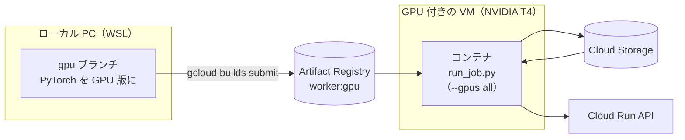

# Step 7 詳細手順：GPU を使って性能を比べる（任意）

[[image-video-recognition-google-cloud-handson]] の Step 7 を、普段 Python や Google Cloud を使わない人でも進められるように詳しく書いた手順書です。[[image-video-recognition-step6-compute-engine]]（Step 6）までが終わっていることが前提です。

このステップは**任意**です。GPU を使わない場合は、Step 8「後片付け」に進みます。

## 0. この手順書について

### このステップでやること

Step 6 の VM（CPU だけ）と同じ処理を、**GPU 付きの VM** で動かし、速さと料金を比べます。



`video.py`・`run_job.py`・`Dockerfile` は変えません。変えるのは、PyTorch を GPU 版にすることと、VM に GPU を付けることだけです。

### かかる時間

| 作業                                     | 目安                                                 |
| ---------------------------------------- | ---------------------------------------------------- |
| GPU の割り当ての申請（第2章）            | 申請は10分。**承認まで数時間〜数日かかることがある** |
| GPU 版のイメージを作る（第3章）          | 30〜40分（イメージが大きいため）                     |
| GPU 付きの VM を作って動かす（第4〜5章） | 1時間                                                |
| 比べて表にまとめる（第6章）              | 30分                                                 |

GPU の割り当ての承認には時間がかかることがあるので、**第2章の申請は、Step 4〜5 を進めているうちに済ませておく**と待たずに済みます。

### 前提

- Step 6 が終わっていて、イメージ（`worker:cpu`）・VM 用のサービスアカウント（`recognition-worker`）・API があること
- Step 6 で、CPU の VM での処理時間を記録していること
- プロジェクトのフォルダが Git で記録されていて、Step 6 までの変更がコミットされていること（`git status` で確かめる）
- ターミナルを開いたら、最初に `cd ~/dev/image-recognition-handson` と `source cloud-env.sh` を実行すること

### 費用について

GPU 付きの VM は、CPU だけの VM より**1時間あたりの料金がかなり高く**なります。動かしたままにしないよう、**測り終わったらすぐに削除します**（第7章）。料金は GPU の種類・リージョンで変わるので、公式の料金ページで確認してください。

### このステップの作り方と、その理由

| 作り方                                                              | 理由                                                                                               |
| ------------------------------------------------------------------- | -------------------------------------------------------------------------------------------------- |
| GPU 版の設定は、Git の**別のブランチ**（`gpu`）で行う               | ローカルの WSL は CPU 版のまま保ちます。終わったら元のブランチに戻るだけで、CPU 版の設定に戻せます |
| GPU 版の設定にしたあと、ローカルで `uv sync`・`uv run` をしない     | 実行すると、WSL にも GPU 版の PyTorch（数GB）が入ってしまいます。GPU は WSL では使いません         |
| GPU は NVIDIA T4 を使う                                             | 推論（学習済みモデルで検出すること）には十分で、GPU の中では安いほうです                           |
| VM の OS は、GPU のドライバ入りの Deep Learning VM のイメージにする | GPU のドライバを自分で入れる手間を減らすためです                                                   |
| VM には Step 6 と同じ専用のサービスアカウントを付ける               | 新しい権限を足さずに済みます                                                                       |

## 1. GPU を使うと何が変わるか

### 1-1. GPU とは

GPU（Graphics Processing Unit）は、同じ種類の計算を大量に同時に行うのが得意な部品です。YOLO などの AI の計算は、ほとんどが「たくさんの数の掛け算・足し算」なので、CPU より GPU のほうが何倍も速く計算できます。

### 1-2. GPU を使うために必要なもの

| 必要なもの                                                      | 用意する方法                                                                                                           |
| --------------------------------------------------------------- | ---------------------------------------------------------------------------------------------------------------------- |
| GPU 付きの VM                                                   | VM を作るときに GPU を付ける（4-2）                                                                                    |
| NVIDIA ドライバ（GPU を動かすソフト）                           | Deep Learning VM のイメージに入っている                                                                                |
| NVIDIA Container Toolkit（コンテナから GPU を使うためのソフト） | 入っていなければ入れる（4-5）                                                                                          |
| GPU 版の PyTorch                                                | GPU 版のイメージ（`worker:gpu`）に入れる（第3章）。GPU 版の PyTorch には、GPU 用の計算ライブラリ（CUDA）も含まれている |

`video.py` は書き換えません。Ultralytics は、GPU が使えるときは自動で GPU を使います。

### 1-3. GPU の候補

| GPU              | マシンタイプ                                         | 主な用途                                         |
| ---------------- | ---------------------------------------------------- | ------------------------------------------------ |
| NVIDIA T4        | N1（`n1-standard-4` など）に GPU を付ける            | 小規模な推論。安い。**このステップで使う**       |
| NVIDIA L4        | G2（`g2-standard-4` など。GPU が最初から付いている） | 推論・動画処理。T4 より新しく速い                |
| NVIDIA A100 など | A2 など                                              | 大きなモデルの学習・推論。このハンズオンには過剰 |

使える GPU・ゾーン・料金・在庫は変わります。VM を作る時点で公式情報を確認します。

## 2. GPU の割り当てを申請する

新しいプロジェクトでは、GPU の**割り当て**（使える数の上限）が 0 になっていることが多く、そのままでは GPU 付きの VM を作れません。

### 2-1. 今の割り当てを確かめる

```bash
# 全リージョンの合計で使える GPU の数
gcloud compute project-info describe --flatten=quotas \
  --format="table(quotas.metric,quotas.limit,quotas.usage)" | grep -E "METRIC|GPUS_ALL_REGIONS"

# 東京リージョンで使える T4 の数
gcloud compute regions describe $REGION --flatten=quotas \
  --format="table(quotas.metric,quotas.limit,quotas.usage)" | grep -E "METRIC|NVIDIA_T4_GPUS"
```

`LIMIT` の列が、使える数の上限です。どちらも 1 以上なら、第3章に進めます。

### 2-2. 引き上げを申請する（ブラウザで行う）

どちらかが 0 なら、Google Cloud Console で申請します。

1. 「IAM と管理」→「割り当てとシステム上限」を開く
2. フィルタで `GPUS_ALL_REGIONS` を探して選び、「割り当てを編集」から新しい上限を `1` にして申請する
3. 同じように、`NVIDIA_T4_GPUS`（リージョンが `asia-northeast1` のもの）を `1` にして申請する
4. 申請の理由には、「推論の性能を比べる検証のため、T4 を1つ使いたい」などと書く

承認されると、メールで知らせが届きます。数分で承認されることもあれば、数日かかることもあります。課金の実績が少ない新しいプロジェクトでは、承認されないこともあります。その場合は、Step 6 までの結果と Step 5 の比較で、このハンズオンを終えても構いません。

## 3. GPU 版のイメージを作る

### 3-1. gpu ブランチを作る

```bash
git status            # 変更が残っていないことを確かめる（残っていればコミットする）
git switch -c gpu     # gpu ブランチを作って切り替える
```

### 3-2. PyTorch を GPU 版に戻す

Step 1 の 2-3 で `pyproject.toml` の末尾に書き足した、CPU 版の設定を消します。VS Code で `pyproject.toml` を開き、次の部分（`[[tool.uv.index]]` から `torchvision = ...` まで）を削除して保存します。

```toml
[[tool.uv.index]]
name = "pytorch-cpu"
url = "https://download.pytorch.org/whl/cpu"
explicit = true

[tool.uv.sources]
torch = [{ index = "pytorch-cpu" }]
torchvision = [{ index = "pytorch-cpu" }]
```

設定を消したら、`uv.lock` を作り直します。

```bash
uv lock
grep -A2 'name = "torch"' uv.lock | head -3
```

`uv lock` は `uv.lock` を書き換えるだけで、ライブラリは入れ直しません。`torch` の行に `+cpu` が付いていなければ、GPU 版に変わっています。

> **ここで `uv sync` や `uv run` を実行しない**
> 実行すると、WSL のプロジェクトにも GPU 版の PyTorch（数GB）が入ります。WSL では GPU を使わないので、無駄になります。3-4 で元のブランチに戻るまで、`uv` のコマンドは `uv lock` だけにします。

### 3-3. Cloud Build で GPU 版のイメージを作る

```bash
export IMAGE="${REGION}-docker.pkg.dev/${PROJECT_ID}/recognition/worker"
time gcloud builds submit --tag="${IMAGE}:gpu" --timeout=3600s .
```

- `Dockerfile` は Step 6 と同じです。`uv.lock` が GPU 版に変わったので、GPU 版の PyTorch が入ります
- GPU 版の PyTorch は大きいので、CPU 版より時間がかかります（30分ほど）。`--timeout=3600s` で、待ち時間の上限を1時間にしています
- 最後に `STATUS` が `SUCCESS` と表示されれば成功です

```bash
gcloud artifacts docker images list ${REGION}-docker.pkg.dev/${PROJECT_ID}/recognition --include-tags
```

`worker` に `cpu` と `gpu` の2つのタグがあることを確かめます。

### 3-4. 元のブランチに戻る

GPU 版の設定を `gpu` ブランチに記録してから、元のブランチに戻ります。

```bash
git add pyproject.toml uv.lock
git commit -m "Step 7: GPU 版の PyTorch でイメージを作る"
git switch -
grep -c "pytorch-cpu" pyproject.toml
```

最後のコマンドで `3` などの数字（0 以外）が表示されれば、CPU 版の設定に戻っています。

## 4. GPU 付きの VM を作る

### 4-1. T4 が使えるゾーンを確かめる

```bash
gcloud compute accelerator-types list --filter="zone~asia-northeast1 AND name=nvidia-tesla-t4"
```

一覧に出たゾーン（例：`asia-northeast1-a`）のどれかを使います。

### 4-2. Deep Learning VM のイメージを選ぶ

Deep Learning VM のイメージは、GPU のドライバなどが入った VM 用の OS です。イメージの名前（ファミリー）は、新しい版が出ると変わります。作る時点のものを確かめます。

```bash
gcloud compute images list --project=deeplearning-platform-release \
  --filter="family~pytorch" --format="value(family)" | sort -u
```

2026年11月の時点では、`pytorch-2-9-cu129-ubuntu-2404-nvidia-580` を使いました。名前は、PyTorch 2.9・CUDA 12.9・Ubuntu 24.04・NVIDIA ドライバ 580 系の組み合わせを表しています。イメージに入っている PyTorch は使いません（コンテナの中の PyTorch を使います）。ドライバが入っていることが大事です。

### 4-3. VM を作る

```bash
gcloud compute instances create recognition-gpu \
  --zone=${REGION}-a \
  --machine-type=n1-standard-4 \
  --accelerator=type=nvidia-tesla-t4,count=1 \
  --maintenance-policy=TERMINATE \
  --image-family=pytorch-2-9-cu129-ubuntu-2404-nvidia-580 \
  --image-project=deeplearning-platform-release \
  --metadata=install-nvidia-driver=True \
  --boot-disk-size=100GB \
  --service-account="recognition-worker@${PROJECT_ID}.iam.gserviceaccount.com" \
  --scopes=cloud-platform
```

| オプション                                    | 意味                                                                                |
| --------------------------------------------- | ----------------------------------------------------------------------------------- |
| `--zone=...-a`                                | 4-1 で T4 が使えたゾーン                                                            |
| `--machine-type=n1-standard-4`                | CPU 4つ・メモリ 15GB（T4 を付けられる N1 のマシン）                                 |
| `--accelerator=type=nvidia-tesla-t4,count=1`  | T4 を1つ付ける                                                                      |
| `--maintenance-policy=TERMINATE`              | GPU 付きの VM は、Google の保守のときに別のホストへ移せないので、保守のときは止める |
| `--image-family=...` ・ `--image-project=...` | 4-2 で選んだ Deep Learning VM のイメージ                                            |
| `--metadata=install-nvidia-driver=True`       | 最初の起動のときに、GPU のドライバを用意する                                        |
| `--boot-disk-size=100GB`                      | GPU 版のイメージ（数GB）を置くため、ディスクを大きめにする                          |
| `--service-account=...`                       | Step 6 と同じ、VM 専用のアカウント                                                  |

`ZONE_RESOURCE_POOL_EXHAUSTED`（そのゾーンの GPU が足りない）と表示されたら、4-1 で確かめた別のゾーンに変えて作り直します。

### 4-4. VM にログインして、GPU が見えるかを確かめる

```bash
gcloud compute ssh recognition-gpu --zone=${REGION}-a
```

ここからは **VM の中**で実行します。

```bash
nvidia-smi
```

`Tesla T4` と書かれた表が表示されれば、GPU とドライバが使えています。`command not found` や `NVIDIA-SMI has failed` の場合は、最初の起動のドライバの準備が終わっていません。数分待ってから、もう一度実行します。

### 4-5. コンテナから GPU を使えるようにする

まず、Docker と NVIDIA Container Toolkit が入っているかを確かめます。

```bash
docker --version
nvidia-ctk --version
```

**どちらも版が表示された場合**は、4-6 に進みます。

**`docker` が見つからない場合**は、Docker を入れます。

```bash
sudo apt-get update
sudo apt-get install -y docker.io
```

**`nvidia-ctk` が見つからない場合**は、NVIDIA の公式手順で NVIDIA Container Toolkit を入れます。

```bash
curl -fsSL https://nvidia.github.io/libnvidia-container/gpgkey | sudo gpg --dearmor -o /usr/share/keyrings/nvidia-container-toolkit-keyring.gpg
curl -s -L https://nvidia.github.io/libnvidia-container/stable/deb/nvidia-container-toolkit.list | \
  sed 's#deb https://#deb [signed-by=/usr/share/keyrings/nvidia-container-toolkit-keyring.gpg] https://#g' | \
  sudo tee /etc/apt/sources.list.d/nvidia-container-toolkit.list
sudo apt-get update
sudo apt-get install -y nvidia-container-toolkit
sudo nvidia-ctk runtime configure --runtime=docker
sudo systemctl restart docker
```

### 4-6. Docker を使う準備をする

自分のアカウントで `docker` を使えるようにし、Artifact Registry からイメージを取れるようにします。

```bash
sudo usermod -aG docker $USER
exit
```

`docker` のグループに入ったことを反映するため、いったんログアウトしました。手元の WSL から、もう一度ログインします。

```bash
gcloud compute ssh recognition-gpu --zone=${REGION}-a
```

VM の中で、Artifact Registry の設定をします。Deep Learning VM のイメージには gcloud が入っているので、それを使います。

```bash
gcloud auth configure-docker asia-northeast1-docker.pkg.dev --quiet
```

## 5. GPU 付きの VM で動かす

### 5-1. コンテナから GPU が見えるかを確かめる

VM の中で実行します。`<イメージの名前>` は、手元の WSL で `echo ${IMAGE}:gpu` を実行して確かめた値に置き換えます（Step 6 の 7-2 と同じ要領）。

```bash
docker run --rm --gpus all --entrypoint python <イメージの名前（…/worker:gpu）> \
  -c "import torch; print(torch.__version__, torch.cuda.is_available(), torch.cuda.get_device_name(0))"
```

1回目はイメージのダウンロードに数分かかります。最後に `True Tesla T4` と表示されれば、コンテナの中から GPU が使えています。`False` の場合は、`--gpus all` を付け忘れているか、4-5 の NVIDIA Container Toolkit の設定ができていません。

### 5-2. 処理して、時間を測る

Step 6 と同じ動画（`vm-test.mp4`）を処理します。`<…>` の部分は、Step 6 の 7-2 でメモした値（イメージは `:gpu` のほう）に置き換えます。

```bash
time docker run --rm --gpus all \
  -e API_URL=<API の URL> \
  <イメージの名前（…/worker:gpu）> \
  <動画の場所（gs://…/input/vm-test.mp4）>
```

Step 6 と同じく、最後に `{'video_id': 'vm-test', 'tracks': …}` が表示されれば成功です。同じコマンドを**もう一度**実行し、2回目の `real` を記録します（1回目は GPU の準備の時間が多く含まれるため）。

`--gpus all` を外して実行すると、同じ VM・同じイメージで CPU だけを使ったときの時間も測れます。

測り終わったら、VM からログアウトします。

```bash
exit
```

## 6. 比べる

### 6-1. 処理時間と料金の表

ここまでの記録を、1つの表にまとめます。

| 指標                                   | ローカル PC（WSL） | VM（CPU、Step 6）    | VM（GPU、このステップ） | Video Intelligence API（Step 5） |
| -------------------------------------- | ------------------ | -------------------- | ----------------------- | -------------------------------- |
| 80秒のサンプル動画の処理時間（`real`） | （Step 2 の 6-3）  | （Step 6 の 7-4）    | （5-2）                 | （Step 5 の 4-1）                |
| 処理 FPS（795フレーム ÷ 処理時間）     |                    |                      |                         | ―                                |
| 1時間あたりの料金                      | 無料               | （公式の料金ページ） | （公式の料金ページ）    | ―                                |
| 1分の動画を処理する料金                | 無料               |                      |                         | （公式の料金ページ）             |

「1分の動画を処理する料金」は、次のように計算します。

```text
1分の動画を処理する料金 ＝ 1時間あたりの料金 × （1分の動画の処理時間〔秒〕 ÷ 3600）
1分の動画の処理時間     ＝ 80秒の動画の処理時間 × （60 ÷ 80）
```

GPU 付きの VM は1時間あたりの料金が高くても、速く終わるぶん、1本あたりの料金は安くなる場合があります。

### 6-2. 考えること

表を見ながら、次を自分の言葉でまとめます。

- このサンプル動画（80秒・10 FPS・小さめの解像度）では、GPU でどのくらい速くなったか。短い動画では、モデルの読み込みや GPU の準備の時間が大きく、差が出にくいことにも注意する
- 30 FPS・フル HD のカメラの動画を、1日に何時間分も処理するなら、どれを選ぶか
- リアルタイム（映像を遅れずに処理）が必要な用途なら、どれを選ぶか

## 7. GPU 付きの VM を削除する

測り終わったら、**すぐに削除**します。

```bash
gcloud compute instances delete recognition-gpu --zone=${REGION}-a
```

`Do you want to continue (Y/n)?` と聞かれたら `Y` を押します。Google Cloud Console の「Compute Engine」→「VM インスタンス」で、`recognition-gpu` が無くなったことを確かめます。

## 8. うまくいかないとき

| 症状                                                                                               | 原因と対処                                                                                                            |
| -------------------------------------------------------------------------------------------------- | --------------------------------------------------------------------------------------------------------------------- |
| VM の作成で `Quota 'GPUS_ALL_REGIONS' exceeded` や `NVIDIA_T4_GPUS`                                | GPU の割り当てが 0。第2章の申請をして、承認を待つ                                                                     |
| VM の作成で `ZONE_RESOURCE_POOL_EXHAUSTED`                                                         | そのゾーンの GPU が一時的に足りない。別のゾーンで作るか、時間をおいて試す                                             |
| VM の作成で `image family ... was not found`                                                       | Deep Learning VM のイメージの名前が変わった。4-2 で今の名前を確かめる                                                 |
| `nvidia-smi` が `command not found`                                                                | 最初の起動のドライバの準備が終わっていない。数分待つ。10分以上たっても同じなら、VM を作り直す                         |
| `docker: Error response from daemon: could not select device driver "" with capabilities: [[gpu]]` | NVIDIA Container Toolkit が入っていない、または設定されていない。4-5 を行う                                           |
| `docker: permission denied`                                                                        | 4-6 で `docker` のグループに入れたあと、ログインし直していない                                                        |
| イメージを取れない（`unauthorized` など）                                                          | 4-6 の `gcloud auth configure-docker` をしていない                                                                    |
| `torch.cuda.is_available()` が `False`                                                             | `--gpus all` を付けていない、または、イメージが `:cpu` のほうになっている。3-2 で `+cpu` が消えたかを確かめる         |
| `CUDA driver version is insufficient`                                                              | VM のドライバが、イメージの中の PyTorch の CUDA より古い。より新しい Deep Learning VM のイメージで VM を作り直す      |
| Cloud Build で時間切れ（`TIMEOUT`）                                                                | GPU 版のイメージは大きい。`--timeout` を長くする                                                                      |
| 元のブランチに戻ったのに、`pyproject.toml` が GPU 版のまま                                         | `gpu` ブランチでコミットせずに戻った。`git switch gpu` で戻り、3-4 のコミットをしてから、もう一度 `git switch -` する |

## 9. 完了条件

- [ ] GPU 版のイメージ（`worker:gpu`）を作った
- [ ] GPU 付きの VM で、コンテナの中から GPU が見えた（`True Tesla T4`）
- [ ] GPU 付きの VM で処理した結果が、Cloud Storage と Firestore に入った
- [ ] 6-1 の表を埋め、「この用途に GPU は必要か」を数字で説明できる
- [ ] GPU 付きの VM を削除した
- [ ] ローカルの WSL が、CPU 版の設定のブランチに戻っている

## 10. このあとの Step とのつながり

| Step 7 で用意したもの            | 使う Step   | 使い方                                                                            |
| -------------------------------- | ----------- | --------------------------------------------------------------------------------- |
| GPU 版のイメージ（`worker:gpu`） | Step 8      | Artifact Registry ごと削除する                                                    |
| `gpu` ブランチ                   | ―           | GPU 版のイメージを作り直したいときに使う。要らなければ `git branch -D gpu` で消す |
| 6-1 の表                         | 計画の第2章 | Cloud Run の GPU や Cloud Run Jobs など、他の動かし方を選ぶときの判断の材料にする |

次は Step 8「後片付け」に進みます。
